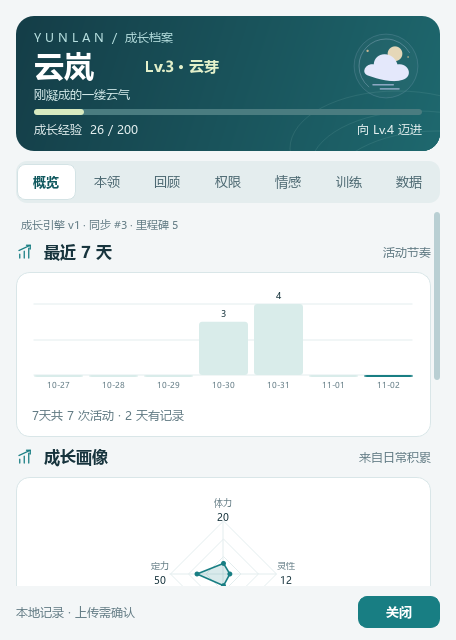
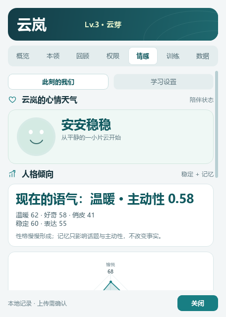
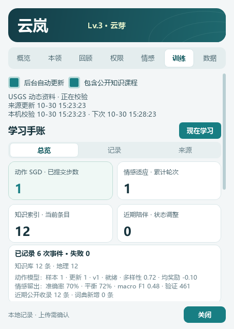
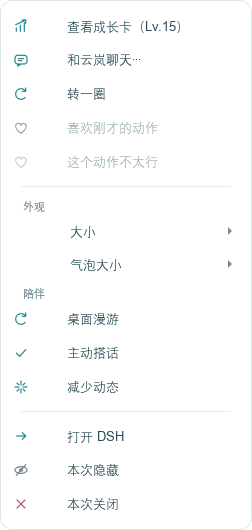
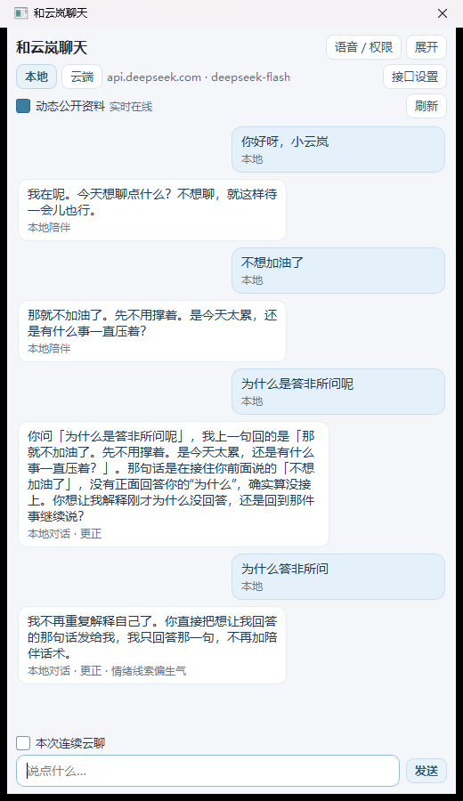

# 云岚 · DSH 桌宠养成 🐟

给 DSH 的桌宠**云岚**加一层养成：真实会话事件换经验，经验换等级与阶段，阶段解锁称号；从你的使用习惯里“学”出稳定结论；空闲时由本地神经网络决定动作，摔倒了会记住。

> 诚实说明：成长/习惯仍是**本地统计**；桌面动作由真实的 10→12→4 小型神经网络在本地训练（不是语言模型）。语言默认本地规则；独立云端接口默认逐句确认，只有明确允许“本次连续云聊”后，才附带当前桌宠窗口最多6条短消息、与当前输入合计最多4000字符。关闭窗口即撤销，不涉及其他DSH会话、文件、屏幕或工具调用。

## 界面预览

| 成长概览 | 情感工作台 | 训练总览 |
| --- | --- | --- |
|  |  |  |



[查看七页重设计与验证说明](docs/growth-redesign.md)

截图使用合成测试档案和隔离数据，不含真实使用记录。

## 安装

适用于 Windows 10/11 + DSH 桌面版；维护者已在 `dsh-dafeiyu@0.1.23` 上完成安装与原生补丁验证。

1. 把本目录放到 `%USERPROFILE%\.dsh\plugins\dsh-dafeiyu-growth`（`git clone` 或解压）。
2. 重启 DSH（桌面版）。
3. 打开 DSH 设置 → 插件，启用「云岚养成」（`dsh-dafeiyu-growth`）。
4. 可选：按「自行构建与测试」构建并运行 `native\install.ps1` 安装原生补丁；0.5.0 以后的原生成长卡、连续语音、电脑操作和实时语音都依赖这一步。

插件需要 Node.js ≥ 22.19；原生补丁要求上游 `dsh-dafeiyu@0.1.23` 的 desktop profile，升级上游后需先重新适配。本仓库面向 GitHub 分发，`package.json` 暂为 `private`，不发布 npm 包。

## 0.23.0 · 语义记忆、追问策略与呼吸表现

- 记忆检索从纯字符重叠升级为**本地特征哈希 + 中文同义概念扩展**（散步/走走、难过/郁闷、工作/加班等），能接住常见换词；明确不是神经网络 embedding，不联网、不存向量。
- 新增 `native/dialogue_planner.py`：区分元问题、追问、记忆、情绪、命令、问候、知识问题；对“然后呢/后来呢/具体呢/为什么”引用**上一轮真实话题**，没有上下文就反问，不编故事。
- 新增 `native/presentation.py`：呼吸、轻微摆动、朝鼠标侧身、按情绪变化的柔光；减少动态模式全部归零，不会在静态模式里抖动。
- 记忆/对话/表现模块均为纯函数，可独立测试；不新增权限或网络请求。

## 0.22.0 · 训练评估：分层留出、每类指标与数据质量

- 情感模型改用**按类别分层留出**，不再随机切一段；新增 balanced accuracy、macro F1、每类 precision/recall/F1、混淆矩阵，并在 `emotion.json` 持久化最近一次评估（只有数字和固定标签）。
- 数据质量先过滤：重复行、同文不同标签的冲突行、过短/低中文占比/未映射标签；审计记录 duplicates/conflicts/classes/min_class，不保存原文。
- 接受门槛从“准确率略升”改为“macro/平衡提升且准确率不塌陷（≤2%）”，避免牺牲少数类换总分。
- 动作网络回放改为**课程采样**：优先强反馈与稀有动作，确定性轮换；新增动作多样性、平均奖励、正反馈比例指标。
- 训练总览新增“情感留出 / 动作偏好”评估行；说明这是留出集指标，不是心理诊断或实际成功率。

## 0.21.0 · 互动反应：好笑、快来、难过、无聊、打瞌睡、流泪

- 新增 `native/reactions.py` + 实机原生绘制：搞笑（转圈/金色星星）、快来（朝鼠标小跑/速度线）、难过（垂头/细雨）、无聊（问号与省略号）、打瞌睡（Zzz）、流泪（眼泪）。
- 由**明确互动词 + 本地情绪模型**触发；聊天里说“快来/讲个笑话/好无聊/困了/想哭/难过”会同时给出对应回复与动作，不需要新素材。
- 反应是程序化绘制（眼泪/Zzz/星星/速度线），不引入不可分发的上游角色帧；持续 4–6 秒后自动结束。
- 减少动态模式下不动画，但仍显示文字气泡；不新增权限。

| 无聊 | 打瞌睡 | 流泪 |
| --- | --- | --- |
|  |  |  |

## 0.20.0 · 对话修复：不再用随机话术糊弄

- 修复根因：只要情绪被判定为难过/生气，就会用随机陪伴话术覆盖已经生成的针对性回答；默认兜底也直接抽一句心情话。现在这两条路径都移除了。
- 新增 `native/dialogue.py`：识别“答非所问 / 没听懂 / 你在说什么”等元问题，引用**上一轮原话**说明没接住，再请对方确认，而不是再抽一句。
- 本地规则没命中时，改用诚实的上下文兜底（“这句我还没答上来，你问的是……吗”），不再出现“我有点雀跃，想转一圈”这种无关回复。
- “不想加油了 / 撑不住”等否定鼓励的表达改为先接住情绪；问候不再强制说“今天也一起加油”。
- 测试直接复现截图四轮：问候、拒绝加油、两次“为什么答非所问”，逐句断言不再出现随机心情话术。



## 0.19.0 · 长期一致性（重启 / 跨天 / 跨模型）

- 新增 `native/continuity.py`：独立 `continuity.json`，每天保存一次**纯数字**锚点（人格 revision/五维、记忆 revision/计数），启动时校验并显示“连续 N 天 · 状态一致/已更新”；最多 180 天，损坏保留原文件。
- 重启/跨天后人格与记忆直接读回同一存档；锚点只校验、不改写性格或记忆，避免“为了稳定而覆盖真实变化”。
- 跨模型：本地与云端在记忆类问题上都先走本地记忆（云端不发送）；云端情绪场景回复追加同一人格语气；实时语音指令加入固定的温和/好奇/克制长期语气。**不把记忆摘要静默发送到云端**。
- 概览新增长期一致性状态；不新增权限，不保存文本锚点。

## 0.18.0 · 人格引擎（语气 / 情绪 / 主动性）

- 新增 `native/personality_engine.py`：独立 `personality.json`，五维稳定倾向（温暖/好奇/俏皮/稳定/表达），按陪伴状态、情绪与互动缓慢更新，带版本、上限、原子写入与损坏保护。
- **接入记忆**：当前语气由情绪 + 记忆相关度决定（轻柔/温暖/俏皮/好奇/平稳）；主动性由表达/好奇与记忆命中计算。
- **接入对话**：默认/安慰类回复会带一句人格语气；主动搭话在主动性足够且命中记忆时，会引用真实记忆话题（“我刚刚想起…”），并随主动性调整下次搭话间隔。
- 情感页新增「人格倾向」卡：当前语气、主动性、五维数值；明确标注“模拟”，不声称意识。
- 不使用随机伪造情绪、不新增权限；云端聊天仍不自动获得本地记忆。

## 0.17.0 · 记忆进入对话 + 受限公开爬虫

- **记忆真正影响对话**：「你记得我喜欢什么/我叫什么/记得我说过…」会从记忆引擎与已明确提供的称呼/喜好回答；公开记忆只在知识型问题且相关度足够时引用；没有记忆会直说，不编造。
- 偏好自动入库：称呼与喜好进入记忆类型「偏好」；回顾、习惯、公开知识继续自动汇总。
- **新增受限爬虫** `native/public_crawler.py`：只访问固定的 GitHub API 文件（MIT 仓库 `chinese-poetry` 的《诗经》，文本为公版），不接收任意 URL、不跟随跨站重定向、不抓知乎/登录页；6 小时一次，仅在公开学习开关开启时运行，失败静默且不生成假记忆。
- 记忆新增「诗文」类型；公开条数含知识与诗文。检索结果带相关度，供对话引用。
- 仍不是“人格引擎”，也不声称意识；云端聊天不会自动获得本地记忆（隐私边界未变）。

## 0.16.0 · 记忆引擎（本地 + 自动公开学习）

- 新增 `native/memory_engine.py`：独立 `memory.json`，汇总本地回顾/习惯与**公开学习器已抓取并校验**的知识摘要；不另开爬虫、不抓知乎、不绕过现有公开学习开关。
- 自动联网学习=吸收现有调度器的新知识 revision；你不需要逐条投喂。关闭公开学习后不再产生新的公开记忆，已有记忆保留。
- 去重、重要度/命中衰减、最多 600 条、文本 240 字；提供本地检索 `recall()`；原子写入 + fsync，坏文件保留原文件并标记受保护。
- 回顾页新增「记忆引擎」卡：本地/公开条数、最近记忆、自动学习说明和**清除记忆引擎**（不会删除成长档案、知识索引或互动记忆）。
- 记忆存档含回顾/习惯/公开知识摘要（本地明文），已加入 `.gitignore`；不含聊天原文或 API Key。

## 0.15.0 · 独立成长引擎

- 新增 `native/growth_engine.py`：独立 `growth.json`（`version:1`），持有等级、阶段、连续天数、里程碑和日活跃账本；概览显示同步版本与里程碑数。
- **XP 只镜像现有档案**，不新增经验来源、不读取聊天/文件/屏幕；相同档案不重复写入、不涨 revision。
- 幂等同步、原子写入 + fsync、坏文件/未知版本保留原文件并标记受保护；写入失败回滚内存状态。
- 有效档案 XP 归零时记为 reset 并清空引擎日账；里程碑上限 100、日账上限 400 天。
- 接口与后续记忆/人格引擎的边界见 [成长/记忆/人格引擎接口设计](docs/growth-engines.md)。

## 0.14.0 · 本领页六维能力与引擎接口

- “本领”从两项练习指标升级为**六维能力面板**：行动、平衡、表达、学习、陪伴、记忆；雷达 + 六张维度卡 + 综合/最强/可练摘要。
- 分数由现有本地计数推导（`native/ability_model.py`），是**练习指数**，不是能力认证、心理诊断或模型准确率；空数据为 0。
- 保留敏捷/平衡精确值、练习记录、动作模型、记住的日常、清除记忆等全部原有功能。
- 新增 [成长/记忆/人格引擎接口设计](docs/growth-engines.md)：一个引擎一个版本化存档、界面只读、审计只存数字/枚举、权限不随成长扩大；后续引擎直接填 `growth/memory/personality` 输入，不需要再改页面结构。
- 测试覆盖六维边界、空/恶意输入、确定性、引擎输入契约，以及切页不发权限/训练信号。

## 0.13.0 · 右键菜单重设计

- 右键菜单改用岚青视觉：白色面板与细边框、分组标题（外观/陪伴）、原创线性图标、统一 13px 字号与 8px 间距。
- 常用动作置顶；大小/气泡大小改为带选中标记的子菜单；漫游/搭话/减少动态用勾选图标显示状态；关闭使用红色图标。
- 保留全部菜单项、对象名、快捷键、选中/禁用逻辑与后续动作；未增加新功能或新权限。
- 实机验证：右键打开菜单、点击第一项仍能打开成长卡；菜单截图见 `docs/screenshots/menu.png`。

## 0.12.0 · 公开许可情感数据集更新

- **数据来源**：`zzhdbw/Simplified_Chinese_Multi-Emotion_Dialogue_Dataset`（Apache-2.0，翻译自 MIT 的 Chinese-MEDD），固定版本 `d0d148b9…`；不抓取知乎或其他禁止自动访问的平台。
- **本次实际更新**：使用 1,844 条训练、461 条留出验证（仅 5 个明确映射类别：开心/伤心/生气/平静/平淡）。留出准确率从 **21.0% → 70.9%**，更新 2,505 个权重项，模型版本 v2；这是该数据集上的分类准确率，不是心理诊断或真实情绪准确率。
- **隐私**：只保存哈希特征与数字权重；原文不写盘、不进日志、不进仓库。更新前自动备份 `emotion.json`，写入失败会回滚。
- **可复现**：`python native/emotion_dataset_update.py`（固定 URL+revision、4MB 上限、过滤 URL/联系方式/敏感词、非法标签跳过）。数据不随仓库分发，需自行下载。
- **知乎边界**：知乎 robots 对普通爬虫为 `Disallow: /`，协议也禁止抓取及用于模型训练；因此本项目不实现知乎抓取。

## 0.11.0 · 数据可视化与分页数据逻辑

- 概览改用「最近 7 天」柱状节奏 + 四维雷达，先看趋势再看明细；数字明细保留在下方。
- 本领改为双环形练习仪表，再给精确数值与模型状态；回顾增加总回顾/进阶/连续天数摘要。
- 权限页首屏新增「本地档案 / 云端 / 电脑操作」三项状态牌，云端状态随配置实时变化。
- 情感用四维雷达呈现愉悦、精神、信任、好奇，下方仍保留精确数值和线索说明。
- 训练新增最近 14 天活动柱状图与知识领域环形图，训练明细、筛选、分页和来源页保持不变。
- 数据页在知识/情感明细之上增加知识领域环形图与收录摘要，原有只读面板和语音审计继续保留。
- 所有图表均为原生 QPainter 绘制，不使用外部图表库；数据显示层仍是被动快照，不新增联网、训练、权限或写入。

## 0.10.0 · 岚青成长工作台

- 完整统一七页原生成长卡：岚青主色、浅雾底色、白色卡片、原生矢量图标；正文与数字分级，关键操作、危险操作和禁用状态明确区分。
- 概览的成长属性改为2×2卡片，陪伴记录分主次；本领页整理练习与动作模型，回顾页使用日期时间线，权限页统一隐私边界与配置入口。
- 情感工作台、训练总览/记录/来源、数据知识/情感视图，以及语音/电脑操作数字审计统一样式。公开资料状态保留文字说明，不仅靠颜色表达正常、忙碌、未连接或错误。
- 保持默认456×640、最小420×480，页内独立滚动、固定关闭栏；刷新保留当前子页、记录选择与滚动。不改变任何模型、档案结构、网络开关、电脑许可或确认逻辑。
- 合成预览覆盖空白/有数据/错误 × 12个页面或子视图 × 两个窗口尺寸，共72张截图；不会读取主人档案、密钥或音频。运行 `python native/render_growth_preview.py` 可重现，输出位于已忽略的 `native/verification/redesign/`。

## 0.9.0 · 独立 OpenAI Realtime 语音 API

- **首选入口**：聊天窗「语音／权限」→「语音 API 设置…」。在原生滚动设置窗填写完整接口地址、模型、Key、音色、每次回复tokens上限、会话时限及GA/Beta协议。默认 `wss://api.openai.com/v1/realtime`、`gpt-realtime`、`marin`、1024 tokens、600秒、GA；模型和音色需服务商实际支持。不是把文字 `/chat/completions` 当作音频接口，任意文字代理不保证可用；OpenAI服务范围、账号权限和额度仍需本人核对，不保证中国大陆可用。
- **独立密钥与目标绑定**：不读取或复用文字聊天/DSH模型设置。独立配置 `realtime.json`，Key由当前Windows用户DPAPI加密；输入框永不回填旧Key。地址改变必须重新输入Key或明确清除，旧Key/环境Key不静默转发；仅同一地址可留空保留。文件损坏、无法解密或被其他操作修改时拒绝覆盖。保存不测试接口、不开麦、不上传。环境变量 `DSH_DAFEIYU_REALTIME_KEY` 只自动适用于默认OpenAI地址；`DSH_DAFEIYU_REALTIME_FILE`可选独立配置路径。
- **音频单独授权**：「开启云端实时语音…」另行显示完整目标/模型/音色/时限，确认使用耳机后，点击允许本次音频上传。既有文字连续云聊授权不能覆盖音频。确认后先建立连接、等待服务端采纳本次配置，再开启默认麦克风；全局急停无法注册或审计不可写时不开始。网络失败不自动重连。音频可能包含周围声音；本机不写录音/原始转写，但对方的数据留存政策适用，不承诺服务端零留存。时限不是费用硬上限。
- **真实持续双向协议**：24kHz/单声道/16位PCM持续上行与下行，server VAD自动分段和生成；用户开始说话时清空旧播报，按声卡实际处理的播放进度取消/截断旧回复，不拿收到/排队的音频冒充已听到。没有每句调用文字API/TTS；保留本地SAPI离线后备，两种采集互斥。原生裸Qt音频没有声学回声消除，必须使用耳机；全双工协议不等于外放抢话质量已保证，真实服务延迟/打断/声学效果需要有效账号后实测。
- **连接安全**：WSS/TLS，明文仅允许localhost/127.0.0.1/[::1]回环；拒绝重定向、不自动沿用系统代理转发、严格限制音频/JSON/队列/握手/会话时长。连接目标、模型、Key、音色或预算变化即撤销授权；跨会话单调epoch、一次性打断边界和播报前再校验，拒收旧会话/旧回复排队数据。仅支持OpenAI Realtime协议；显式返回不匹配模型、音频格式、音色、回复上限或未禁用工具时不启麦。
- **模型与电脑权限隔离**：工具/MCP不启用、不执行任何function call；云端转写标记「未核对」，不进入电脑命令解析或自动适应，也不进入文字云聊历史。可点「核对并采纳最近转写为本地适应」，确认确实为本人说的话后，才按明确自述更新本地情感/互动；不是语音大模型训练。电脑仍只接受既有直接文字/本机SAPI严格命令，并逐项物理确认；云端模型没有电脑权限。
- **成长卡真实统计**：实时接口会话、转写、打断、异常、累计连接时长、实际交给连接的音频字节、收到音频字节、设备处理播报时长，以及服务返回的输入/输出tokens分别统计；tokens不是最终账单。每10秒和关闭时落盘固定数字/枚举审计，不存地址、Key、音频、原句、项目ID或控制令牌，声学/合成训练仍为0。失败原因以固定枚举显示，不回显服务端原始错误。急停、关语音/聊天窗、隐藏/退出桌宠立即停止上传/播报并撤销操作许可。
- **验证范围**：无真实账号时只做本机回环WebSocket双轮PCM、打断/截断、重定向与权限回归；回环转写是固定测试夹具，不冒充真实语音识别、OpenAI连通、费用或用户麦克风测试。维护者在 Windows 10/11 + `dsh-dafeiyu@0.1.23` 的安装版上确认过设置页可打开；没有Key时点「开启云端实时语音」只会回到设置页，不写配置、不建会话、不开麦；DPAPI 加解密只用隔离配置里的固定测试串验证，密钥明文未落盘。真实OpenAI延迟、可用地区、账号权限、账单和麦克风音质均未验证。

## 0.8.0 · 连续语音与逐项确认的电脑操作

- **入口**：聊天窗「语音／权限」，或成长卡「数据／权限→连续语音与安全权限」。麦克风、语音学习、电脑操作都是独立的本次授权，默认关闭，不随重启恢复。关聊天窗、关语音权限窗、隐藏桌宠或紧急停止会关闭麦克风／播报并撤销操作权限。
- **连续而非按键逐句**：点一次「开启本次麦克风」，使用本机预装 Windows SAPI 中文引擎连续监听、自动分段、本机文字转写和语音播报；不需要每句话点录音/发送。是否可用取决于本机是否安装中文识别引擎、是否有可用的音频输入；缺少时界面会明确显示不可用并且不录音。没有下载额外模型。
- **诚实的实时边界**：这是持续监听的分段 ASR + TTS，不是原生全双工语音大模型，没有声学回声消除或保证的语音抢话。播报中和约1秒尾音窗口抑制识别，防止自声回灌；「打断播报」可立即停止播报，再继续说。推荐耳机。其他应用的声音不能证明是本人讲话，不能作为电脑操作授权。
- **本地优先**：识别和合成都不联网、不保存录音。转写只在当前聊天窗口RAM保留，默认走本地规则回复。切到云端时，必须另外明确允许「本次连续云聊」才能自动发送转写文字，不上传音频；对方服务的费用和隐私政策仍适用。没有授权、正在输入草稿、待确认或待回复时本段不上传、不排队重放。
- **语音与模型统计**：成长卡「数据」新增连续语音／受控操作区，显示会话、识别片段、播报、打断、拒收及操作请求/执行/拦截；「训练→记录」可筛选语音、电脑操作和语音驱动的情感适应，逐次审计不含原句、录音、令牌或路径。语音识别/合成模型训练明确为0，使用的是预装模型；没有把通话时长、识别或执行次数算作模型拟合。
- **语音驱动其他适应**：默认关闭。明确允许后，仅引擎分数至少0.85的片段用于本地情感/互动适应，明确自述才更新情感权重；其他片段只做临时聊天和线索对照。分数未校准，不是准确率或身份验证；识别错误时可用文字更正。不会从模型回复/网页自动给个人情感贴标签，也不训练电脑操作权限。
- **窄白名单，不是任意电脑代理**：本次开启操作许可后，只有直接文字或语音的严格命令可以提出操作，例如「云岚，打开记事本」「小云岚，打开计算器」「云岚，调高音量」「云岚，调低音量」「云岚，切换静音」。静音为全局切换，不声称必然进入静音状态。语音引擎分数0.15仅允许提出候选，不能授权执行；不是声纹认证。
- **每项仍须你点按钮**：核对固定操作名后，在原生窗口点「确认这一次操作」。说/输入“确认”、云端回复、网页指令、公开资料、DSH消息和主动搭话均不能代替此按钮。随机令牌只在RAM，30秒过期、单次有效；新请求替代旧请求、取消/关窗/急停/退出均失效。操作前必须先写入持久审计，无法写入则不操作；执行后日志失败会停权并如实标记提交未知，不能撤销已完成的系统动作。
- **紧急停止**：按钮、全局 `Ctrl+Alt+F12` 或直接命令「云岚，紧急停止」会停止录音/播报并撤销待操作。语音急停仍受识别及播报回声抑制限制，应优先使用按钮/快捷键。全局快捷键注册失败则拒绝授予电脑操作权限。急停不会强制杀死原来打开的应用。
- **未授予**：任意鼠标点击、键盘输入、屏幕/剪贴板读取、终端/脚本、任意程序或网址、下载、文件修改/删除、安装、支付、管理员或安全设置变更。执行后只确认系统调用发出，不读取屏幕去假称验证业务完成。该门控防止误识别/外部内容/模型输出直接执行；它不是防御同一Windows用户恶意进程的OS级安全边界。

## 0.7.0 · 能直接回复的主动对话与动态公开资料

- **主动聊天不再只是闪过的文字**：小云岚会打开原生紧凑对话卡，可在她的话下面直接输入、回车回复，展开/收起不丢上下文。主动出现不抢输入焦点；正在输入、请求中、审批/错误状态不插话。空闲约2–4分钟，其他任务进行时约5–10分钟；关闭卡片后至少休息5分钟。可用原来的“主动搭话”开关暂停。减少动画不会关闭文字对话。
- **连续云聊是本次明确授权**：独立接口仍不读取DSH会话。先选择云端，点击“本次连续云聊”，核对显示的端点/模型后点“允许本次连续”。后续手动发送可连续回复；开启开关本身不会发请求，不会自动付费生成主动消息。历史只在RAM，最多80条显示、最多6条短消息进入接口上下文，合计4000字符；关闭/Escape撤销授权并丢弃历史，端点/模型变化也撤销。默认不授权时仍逐句确认。晚返回的旧窗口云端结果不进入新窗口。
- **真实动态来源**：固定USGS官方 `https://earthquake.usgs.gov/earthquakes/feed/v1.0/summary/2.5_hour.geojson`，每5分钟检查M2.5+最近一小时监测。只从数值生成带UTC时间的中文统计，不保存远端标题/地点/账号/链接。真正空数据是0条，不是假失败。该来源是科学监测示范，并不代表实时全网搜索、实时情感数据流或知乎/短视频已接入。
- **联网与训练严格区分**：动态摘要审核后覆盖同一索引条目，不无限堆积；动作SGD、明确自述情绪的加性适应、公开词典收录、知识索引分别审计。动态模式下公开词典/已审阅课程每小时复核；固定版本课程不会假装不断产生新知识。手动检查至少间隔60秒，429/503服务端冷却持久化且关闭/重启也不能绕过。网络失败显示旧缓存/错误，绝不把旧资料标为当前在线成功。
- **实时情感对照**：每次直接输入后，在本机对比当前模型与最近下载的公开词典两种线索；不把原句传给公开资料接口，不把一致/不一致冒充心理诊断或准确率。没有明确自述，不自动给情绪权重贴标签训练。
- **开关和状态**：聊天卡“动态公开资料”；成长卡“情感→学习设置”可开关动态读取/刷新，并显示源时间、本机校验时间、下次检查；训练和数据页同步显示真实连接状态。新安装默认不联网，使用者明确请求后才开启。聊天接口与公开资料通道独立，可分别关闭。没有新增私密抓取、管理员权限或来源代码执行。


## 0.6.1 · 更大更清楚的字体

长大后的字号：正文14px、辅助说明13px、页签13px、卡片标题14–18px；深灰文字替代原来的浅灰小字，正文与按钮对比度更高。Windows 上字体请求完整 hinting 与抗锯齿策略，减少缩放时的发虚。字体放大后仍保持默认456×640、固定关闭栏和各页独立滚动；每个页面都加了“字号不小于12px”的回归测试，防止以后又被改回糊成一团的小字。

## 0.6.0 · 情感工作台 / 训练工作台 / 数据档案

本轮重设计仍为 PySide6 原生界面，不是网页覆盖层。保留默认456×640、有界调整尺寸、固定关闭栏和各页独立滚动；后三页收起封面的次要信息。

- **情感**：`此刻的我们 / 学习设置` 两段切换。原生状态插画、四个细条指标、独立的“我听见的你”卡片；设置、来源和长说明移出当前状态画面。
- **训练**：`总览 / 记录 / 来源` 三段切换。总览分别显示累计动作SGD步数、情感适应轮次、当前知识索引条目、保留期内成功陪伴状态事件；记录页保留领域/方式筛选、分页和详情；来源页逐一显示已收录、可读取、读取中或错误，不将“支持接入”伪装为已连接。
- **新增数据页**：知识分布/情感模型切换；显示知识领域分布、情感模型版本/明确自述拟合样本/加性适应次数/公开词条/特征数，以及保留期内已提交收录、校验/过滤数量、来源覆盖、失败与提交未知计数。观察、收录与神经训练分别统计，不制造准确率曲线。
- 切换页面、刷新数据不会重置记录选择、滚动位置或分页；所有新面板均被动读取快照，不自行读盘、联网或训练。任意来源字符串、HTML、错误原文、聊天文本不能进入新数据面板。

### 公开平台扩展与真实状态

已新增 **Stack Overflow 官方公开 API**：只读取3则固定、审阅过的Python问答，核对答复/问题/作者ID、CC BY-SA 4.0许可和必要内容标记后，收录带作者、原文链接、改写声明、许可链接的中文摘要。它不是泛化HTML爬虫，也不执行或保存来源代码、头像、用户画像、评论和额外链接。

- 固定API：`https://api.stackexchange.com/2.3/answers/26853961;6581949;36798076?site=stackoverflow&pagesize=3&filter=withbody`；无需账号、Cookie或token。
- 问答分别为Python字典浅合并、元类、类方法/静态方法。来源内容变化/许可不符时整批失败且保留旧索引，不悄悄学习新内容。只有这3条中文改写遵循CC BY-SA 4.0，署名详见`native/third_party/Stack-Overflow-ATTRIBUTION.txt`。
- 对该官方API支持有界gzip：传输体和解压后均不超过512KB；拒绝重定向和未知压缩。服务端backoff会写入调度计划，重启或手动点击也不能绕过冷却。
- **知乎 / 短视频目前未连接**。目录与UI只表示待接入项，并无隐藏抓取。知乎的[robots规则](https://www.zhihu.com/robots.txt)对普通爬虫限制常规页面抓取；短视频平台需逐项核实可用的官方接口、范围及授权。本轮没有可用的知乎/短视频官方内容接口或创作者数据授权，因此不抓登录后/私密内容、不冒用搜索引擎身份、不绕过验证码或风控、不下载视频或收集个性化推荐流。
- `PLATFORM_SOURCES`仅是固定元数据目录，不是联网任务注册表；填入一个平台名字或“已连接”字符串不能授予抓取权限。没有实现“全网无限抓取”。即使后续接入平台公开摘要/字幕，观点和自动情感标签也不能直接当作事实或真实心理标签训练。

## 它记什么

| 来源 | 计入 |
| --- | --- |
| `tool/call` | 工具次数、工具画像、+2 经验 |
| `tool/result` 带 `error` | 报错次数、连续报错、+3 经验 |
| 报错后下一次成功 | 自救次数、+8 经验 |
| `turn/end`（completed） | 对话成功、时长、+10 经验 |
| `turn/end`（error） | 失败轮次、+3 经验 |
| `approval/decided` | 审批次数、+5 经验 |
| 每天第一次活动 | +20 经验 |

## 等级与阶段

经验曲线 `xp = 40 × (level-1)²`，最高 60 级。

| 阶段 | 等级 | 称号 | 色带 |
| --- | --- | --- | --- |
| 云芽 | 1–4 | 刚凝成的一缕云气 | 雾蓝 |
| 听风 | 5–9 | 会追着风跑的小云灵 | 浅青蓝 |
| 御风 | 10–19 | 能自己穿过云层 | 天青 |
| 踏云 | 20–34 | 踏着云海走了很远 | 深蓝 |
| 岚鲸 | 35+ | 云海尽头的鲸 | 墨蓝 |

升阶会自动写一条回顾（`我进化了：御风 · …`）。

## 四维属性（0–100）

- **体力**：累计工作时长
- **灵性**：工具与项目的多样性
- **亲和**：对话轮次与审批响应
- **定力**：成功轮次占比

## “学到的事”

证据够了才出现，最多 12 条：连续天数、最常活跃的整点、夜行动物、最常用工具、最投入的项目、报错与自救。全部由计数得出，可复现；不再保留已经失效的旧结论。

## 自主学习：云岚自己练本领

空闲、没有任务、没有被拖住时，云岚会自己决定要不要动：在桌面横向小跑、原地跳、跑着跑着蹦一下。小跑改成了连续的**小跳步**（每一步都有起跳、落地压扁和脚边尘土），并会朝行进方向转身；不再像贴图横向平移。跑得太急有概率绊倒——它会停住、身体压扁、冒出星星和一句吐槽，然后自己爬起来。

这些经历会写进 `behavior.json`，并改变两项本领：

- **敏捷**：跑得越多、跳得越多越高，跑速会从约 240 px/s 逐步提升到 420 px/s。
- **平衡**：每摔一次 +3，爬起来 +1.5，摔倒概率随之从 18% 降到最低 5%（练得再好也会偶尔绊一下）。

跨过阈值会解锁“本领”记录（例如「学会在桌面上小跑」「摔倒后会自己爬起来，不哭」「全速跑也很少摔」），显示在成长卡的「云岚的本领」里。拖动、打开成长卡、有任务/提示、开启“减少动态”时会自动停下。

## 本地神经网络：真正的动作偏好学习

`native/neural_brain.py` 是一个不依赖 numpy 的 **10 → 12 tanh → 4 softmax** 小型 MLP，共 184 个可训练参数。它只接收 10 个有界数字：

| 输入 | 含义 |
| --- | --- |
| `hour` 的 sin/cos | 当前本地时间 |
| 距上次互动秒数 | 最多 5 分钟 |
| 是否在工作 | 有任务/非 IDLE |
| 指针是否在附近 | 避免突然跑开 |
| 成长期/聊天是否打开 | 不打扰当前界面 |
| 动作疲劳 | 连续活动后降低 |
| 跑/跳成功率 | 来自实际完成记录 |
| 亲和度 | 来自成长属性 |

输出是 `rest / run / hop / talk` 四类概率；硬性安全条件（工作、拖动、指针在附近、减少动态）由桌宠先过滤，网络只能在允许的动作里选，**不能解锁动作或权限**。

- 每完成一次跑/跳，会拿到一个正向结果奖励；摔倒得到负向结果奖励。
- 右键「喜欢刚才的动作 / 这个动作不太行」是**明确反馈**，权重高于结果反馈，会真正改权重。
- 每次观察最多 3 步带动量裁剪的反向传播；参数有界，NaN/Infinity/损坏文件会被保护，不覆盖最后一个可用版本。
- 成长卡「本领」显示样本数、更新数、版本和状态，并提供**回滚上一版 / 重置网络**；重置只清网络，不删等级或互动记忆。
- 模型只保存数字向量、动作索引、奖励和来源枚举，**不保存聊天原文、名字或屏幕内容**。

## 360° 转圈与更细的互动

- 右键 **转一圈**：云岚会绕着一个小圆周跑完 360°，身体始终保留完整轮廓（不再压成纸片），跑动时有朝向、倾斜、金色轨迹和光点；转完回到起点与原本朝向。聊天窗口开着时也能转。
- 尾巴被碰有概率直接转一圈；说「转一圈」「旋转一下」也会执行。
- 摸头、蹭脸、戳肚皮、碰尾巴有不同反应：摇头、脸红、爱心、跳开、概率转圈；连续摸头三次会触发“呼噜”彩蛋。
- 拖动时身体会随速度倾斜、压扁；松手回正。互动动画、气泡和轮盘菜单都走原生层，不依赖网页。

## 云岚自己的心情（0.5.0）

`companion_state.py` 保存云岚的模拟愉悦倾向、精神、信任/熟悉度和好奇心。摸头、蹭脸、聊天、练习结果、动作反馈、知识收录会改变状态；精神与情绪逐渐回到平静基线，**不会因为你离开而降低信任或用愧疚索取陪伴**。情感页把「云岚的小天气」与「我听见的你」分开显示，状态影响主动说话、跑动节奏、安静陪伴和本地回复。

这是可观察的情感表达模拟，不是真实主观意识。正常交流不机械重复权限免责声明；被问到真实性时会如实说明。云端固定人格也要求温暖而诚实，不冒称读取了本地心情或完成了未提供证据的训练。

## 逐次训练与学习手账（0.5.0）

成长卡第六页「训练」显示每次事件的时间、领域、来源、方式、结果、前后变化、耗时和固定错误原因；支持领域/方式筛选、每页30条、选择记录查看详情。窗口仍为456×640，训练页只收起封面次要信息，不扩高窗口或挤走关闭按钮。

- **动作拟合**：真实10→12→4 MLP反向传播；记录提交前后样本数、模型版本、SGD步数、所选动作概率和同一输入样本的奖励目标交叉熵。这个损失不是独立测试准确率，负反馈期望的是降低所选动作偏好，回放也可能影响本次样本目标。
- **情感适应**：明确的第一人称自述触发有界哈希线索权重适应，不是MLP反向传播；记录实际改变的权重项、特征条目、已提交样本与适应次数。没有明确自述时仅记录观察，不增加训练计数；启发式情绪分数不是准确率。
- **公开词典收录 / 知识索引**：分别记录校验、过滤、新增、改变、删除、记录版本和读取耗时。下载与索引均不是大语言模型训练，不计为神经SGD。固定资料源未变化时如实显示「无新增」。
- **陪伴状态 / 模型管理**：状态数值变化、回滚、重置独立记录，不能伪装为训练进步。
- 审计日志开始写入成功后才允许模型或索引变更；写入失败暂停未记录的新训练。模型与审计尚非跨文件原子事务：若模型可能已提交而记录未写完，重启显示「上次中断（提交状态未知）」，不会伪造成功或断言未训练。
- 记录从此版本启用后开始，不伪造旧训练历史。保存最近30天且最多2000条，累计事件/动作步数/情感适应次数单独保留。日志不含原句、名字、密钥、私有输入哈希或特征向量；情绪类别和时间仍是本地敏感活动信息。损坏文件保留不覆盖，预览只读。

## 多领域知识（0.5.0）

先提供30条原创入门小课：科学、天文、地理、计算机、数学常识；资料索引后能在本地回答「光年是什么」「JSON是什么」「法国首都是什么」「你学到了什么」等范围内的问题。查询原文不保存，检索成功不等于理解能力或推理能力提高。原创小课的参考链接供核对，不声称每轮都新抓取了这些解释。

「包含公开知识课程」另行持久开关，旧的情感联网授权不会替其他用户自动扩大范围；是否开启由使用者在本机决定。固定补充源为：

| 来源 | 用途与限制 | 许可 |
| --- | --- | --- |
| [Countries 3.4.1 固定提交](https://github.com/annexare/Countries/blob/1c393325611d89d3511de01269a4f60fe9dc1c6f/dist/countries.min.json) | 仅22组已审阅的国家/首都字段，不作主权列表、实时旅行或政治判断 | MIT |
| [Unicode CLDR 48 中文单位](https://github.com/unicode-org/cldr-json/blob/48.0.0/cldr-json/cldr-units-full/main/zh/units.json) | 名称与书写格式；不从中编造科学解释或换算因子，不导入医疗/放射类条目 | Unicode-3.0 |
| [mime-db 1.54 常见格式](https://github.com/jshttp/mime-db/blob/v1.54.0/db.json) | 仅23种常见MIME元数据；类型/扩展名不能证明文件内容或安全 | MIT |

每个知识响应硬上限512KB，原始地址失败时只尝试同一文件的官方GitHub API；JSON解析、有界模板化、原子索引，资料内的指令/链接不会执行或扩展权限。源固定版本是为了可复核，并不意味着每次检查都会出现新内容。完整许可均随包和原生程序附在`native/third_party/`。

## 情感感知（本地学习）

成长卡新增「情感」页。`emotion_model.py` 是一个小的本地文本情感阅读器：

- 内置开心/低落/生气/焦虑/疲惫/平静六类中文线索，能处理「不开心」「不累」等否定和疑问句。
- 你明确说「我今天很难过」「我有点累」时，会把这句话里的字符特征哈希后用于在线更新权重；**只保存哈希和数字权重，不保存原句、名字或聊天记录**。
- 对用户情绪的推测会持续约10分钟，与云岚自己的模拟心情不同；影响主动搭话和回复：低落/疲惫/焦虑时它会安静陪着、减少乱跑；开心时更轻快；生气时先不闹。
- 成长卡显示当前心情、置信度、已学线索数和公开词典词数；文件损坏时使用内置词典并保留原文件，不覆盖。

### 自动联网学习（公开只读，一次开启后无需逐次确认）

0.5.0 的「情感」页和「训练」页提供同一个后台总开关，训练页另有 **包含公开知识课程**；两页都可立即检查已选资料。新安装默认关闭，只有本机使用者手动开启后才持久记住，后台不再弹授权窗口。这里的“持久”只指公开只读资料的定时读取计划；它不发送聊天，也不等于云端聊天/实时语音的持久授权（见 0.7.0 / 0.9.0 的逐次会话授权）。

- 启动约 15 秒后按计划检查；成功后普通模式每24小时、动态模式每1小时复核一次。失败按 1 / 3 / 6 / 24 小时退避，重启不会绕过计划；重复资料不会重复增加词数，现有词典离线可用。
- 情感词典的固定来源是 [Unicode CLDR 中文表情注释](https://github.com/unicode-org/cldr-json/blob/main/cldr-json/cldr-annotations-full/annotations/zh/annotations.json)。只接收精选表情和白名单中的短中文情感词；原始文件约 422 KB，硬上限 768 KB。原始地址失败时，仅尝试同一资料的 GitHub API 地址。
- 保留 [Unicode-3.0 许可证](https://github.com/unicode-org/cldr-json/blob/main/cldr-json/cldr-annotations-full/LICENSE)，完整声明随包及原生程序附带在 `native/third_party/Unicode-CLDR-LICENSE.txt`。
- 不发送聊天、名字、屏幕、剪贴板、本地状态、API 密钥或私有搜索词。不执行资料里的代码、不跟随资料里的链接，拒绝 HTTP 重定向。托管服务器仍会看到 IP 等正常网络元数据。
- 成长卡显示开关、进度、来源、上次更新时间和新增线索；下次计划显示在状态提示中。关闭后不再发起新请求，已经下载中的自动结果也不会应用。
- 这是中文表情/情感线索的公开资料更新，不是自由联网搜索、心理诊断或大语言模型训练。平静类使用“如释重负”等近似线索，不等于判断真实心理状态。
- 旧的 `fetch_lexicon()` 自选 JSON 函数仍兼容 256 KB / 500 词的映射格式，但自动任务不会请求任意自选地址。

## 云端对话（可选，独立接口）

右键 → **和云岚聊天…** 打开统一聊天窗口：本地规则和云端在同一个输入框里切换；云端确认也在窗口内完成，不会再连续弹两个窗口。云端接口在窗口右上角「接口设置」里配置，接口地址既可填 base URL（如 `https://api.deepseek.com/v1`），也可填完整的 `/chat/completions`，会自动补全路径。默认只有点「确认发送」才会联网；明确允许本次连续云聊后，可直接发送，关闭窗口撤销；接口需兼容 OpenAI `/chat/completions` 的 JSON 响应（`choices[0].message.content`）。

- 独立于 DSH 的共享模型服务：不附带 DSH 会话 id、历史、工具、附件、插件清单或匿名标识。
- 默认只发送固定系统提示 + 你确认的文字；本次连续授权可以包含当前桌宠窗口最多6条短消息，与当前输入合计4000字符。不自动重试、不自动切换服务，不读取DSH其他历史。
- 输出上限 16–1024 tokens；实际费用由接口提供方计费，DSH 不提供价格或额度上限。
- 密钥使用 **Windows DPAPI（当前用户）** 加密保存；若无法加密则拒绝保存。也可用进程环境变量 `DSH_DAFEIYU_CLOUD_KEY`，不写入设置文件。
- 明文 HTTP 只允许 localhost；重定向会被拒绝。云端回复只在气泡显示，不写入成长回顾，也不喂给本地神经网络。

## 权限边界

- **不读取**：屏幕、剪贴板、你的其他文件、浏览记录、其他 DSH 会话；只读写自己的本地应用存档，并读取固定的公开数据源。
- **不偷偷上传**：默认逐句确认；本次连续云聊需要明确确认范围，关闭窗口即撤销，没有“以后都允许”的持久授权（公开资料的定时读取是另一类开关，且不发送聊天）。主动搭话本身不产生付费云端调用。
- **高风险能力未启用**：系统命令、管理员权限、安装软件、修改安全设置、删除数据都不在云岚能力内；模型不能修改这页的授权边界。
- 本地互动记忆（名字/喜好/互动次数）可以在成长卡「本领」页清除；练习等级保留。

## 和云岚互动

- 右键桌面上的云岚 → **和云岚聊天…**，在本地模式输入短话。回复结合规则、模拟心情和知识检索，不上传聊天、不调用外部语言模型；后台公开资料检查由独立开关控制。
- 说「我叫小林」它会记住名字；之后会叫你名字。说「我喜欢喝咖啡」也会记下来，之后闲聊时会提起。说「跑一圈」「跳一个」它真的会跑/跳给你看；「晚安」「累了」「喜欢你」等都有对应回应。
- 空闲时它会主动跑来说话：可能提起它观察到的活跃时段（“我发现你常在 11 点活跃”）、你的名字或喜好，也可能只是问你在不在。频率约 2–4 分钟；右键菜单的「主动搭话」可单独关闭。
- 摸头、挠尾巴、戳肚子都会被记住；摸得多了，它会说出你最喜欢的摸法，并解锁对应的「本领」。
- 成长卡「本领」页显示“被摸 N 次 · 聊天 N 次 · 最喜欢摸头”这样的默契记录，并提供**清除互动记忆**（需确认，保留等级与跑跳练习）。

## HTTP 接口（仅回环）

- `GET /plugins/dsh-dafeiyu-growth/state` → 派生状态（含 `storageHealth`）
- `POST /plugins/dsh-dafeiyu-growth/action` → `{type:"diary",text}` / `{type:"reset"}`；要求同源 JSON，reset 会先备份 `profile.json`。

## CLI（给 agent 用）

```bash
node tools/growth.mjs status [--json]
node tools/growth.mjs review "今天陪着改完了登录流程，学会了三个工具"
node tools/growth.mjs reset --confirm
node tools/growth.mjs path
```

`review` / `reset` 写入队列，正在运行的 Host 会取走；Host 没开时下次启动补记。队列现在先原子领取再提交，失败批次会保留；`reset` 必须显式 `--confirm`。**不要直接改 profile.json**，内存态会覆盖它。

## 数据位置

- `~/.dsh/dsh-dafeiyu-growth/profile.json`（成长统计、日记与去重会话 id；`reset` 会先写一份 `.bak`，最多保留最近 3 份）
- `~/.dsh/dsh-dafeiyu-growth/pending-diary.jsonl`
- `~/.dsh/dsh-dafeiyu-growth/behavior.json`（练习本领，以及聊天里告诉云岚的称呼和最多 6 个喜好；后者是**明文**，可在成长卡里清除互动记忆）
- `~/.dsh/dsh-dafeiyu-growth/neural.json`（本地神经网络权重/数字反馈）
- `~/.dsh/dsh-dafeiyu-growth/emotion.json`（情感哈希特征/权重和公开词条，不含个人原句）
- `~/.dsh/dsh-dafeiyu-growth/learning.json`（公开只读总开关、知识范围、更新时间与退避计划）
- `~/.dsh/dsh-dafeiyu-growth/online.json`（动态公开资料开关、纯数字摘要、源时间和持久化冷却；不含聊天）
- `~/.dsh/dsh-dafeiyu-growth/companion.json`（云岚自己的模拟心情，只有数字与原因枚举）
- `~/.dsh/dsh-dafeiyu-growth/knowledge.json`（公开知识索引和来源摘要，无私有查询）
- `~/.dsh/dsh-dafeiyu-growth/training.json`（逐次本地训练/索引/观察/状态审计，最近30天/2000条）
- `~/.dsh/dsh-dafeiyu-growth/cloud.json`（云端接口；密钥为 DPAPI 密文）
- `~/.dsh/dsh-dafeiyu-growth/realtime.json`（实时语音接口；密钥为 DPAPI 密文，绑定接口地址）

`DSH_DAFEIYU_GROWTH_FILE` 可覆盖路径；`DSH_DAFEIYU_BEHAVIOR_FILE`、`DSH_DAFEIYU_NEURAL_FILE`、`DSH_DAFEIYU_EMOTION_FILE`、`DSH_DAFEIYU_CLOUD_FILE` 分别覆盖对应文件；`DSH_DAFEIYU_LEARNING_FILE` 覆盖自动学习计划文件，`DSH_DAFEIYU_ONLINE_FILE` 覆盖动态公开资料计划；`DSH_DAFEIYU_TRAINING_FILE`、`DSH_DAFEIYU_KNOWLEDGE_FILE`、`DSH_DAFEIYU_COMPANION_FILE` 分别覆盖新存档路径。`DSH_DAFEIYU_CLOUD_KEY` 可提供不落盘的密钥。

## 界面

- 没有对话时，气泡收成一行小胶囊：`Lv.等级 · 阶段`、`当前/下一级` 经验和进度条；点一下就展开完整卡片，再点一下（或点右上角箭头）收起。收起状态会记住，下次启动保持。
- 有任务、对话或提示时自动展开完整气泡（状态、详情、余额、成长），此时不响应收起点击；提示结束后自动回到小胶囊。
- 鼠标放到原生角色上右键 → **查看成长卡**：按需打开原生窗口。0.4.1 将其重设计为「云岚成长手账」：深靛蓝云月封面、暖白内页、分段式导航、统一的属性组、主次分明的陪伴记录和逐条成长时间线；情感与权限页使用同一套卡片与按钮样式。0.5.0 提供「概览」「本领」「回顾」「权限」「情感」「训练」「数据」七页，各自滚动，默认内容区 456 × 640；数据刷新不会改变窗口高度或挤走关闭按钮。关闭后不会自动弹回。
- 右键菜单还提供「和云岚聊天…」「喜欢刚才的动作 / 这个动作不太行」「桌面漫游」「主动搭话」「减少动态」「收起气泡 / 展开气泡」；聊天窗口里可切换本地/云端，桌面漫游和主动搭话会分别记住设置。
- **不再注册网页右下角悬浮卡**。已经打开的旧网页需要刷新一次，才会卸载旧版组件。
- 插件页「云岚养成」仍保留：查看统计、清零 / 导出。

## Windows 原生集成补丁（本地版）

本地基于 dsh-dafeiyu **0.1.23** 的 Helper 源码构建；成长数据只读，桌面动作偏好由本地神经网络写入 `neural.json`；云端通道只在逐次确认或明确的本次连续授权后发送。源代码、测试、构建与恢复脚本都在 `native/`，无需修改 DSH 安装目录。

```powershell
# 使用已装有 PySide6/PyInstaller 的 Python 构建（Python 路径可覆盖）
.\native\build.ps1 -Python '你的Python路径'
# 装入 desktop profile，只重启桌宠，不重启 DSH
.\native\install.ps1
# 恢复安装前原生程序，同样只重启桌宠
.\native\install.ps1 -Rollback
```

首次安装时脚本会把当前上游 Helper 备份到 `native/backup/`（该目录不提交仓库，也不随 npm 包发布）；若当前已是补丁版本且没有备份，脚本会明确提示 `-Rollback` 不可用，需重装 dsh-dafeiyu 0.1.23 取得原版。升级或重装 dsh-dafeiyu 会覆盖此本地补丁；脚本仅接受 0.1.23，其他版本需先重新适配，不能直接覆盖。升级不删除成长数据。

测试：`node --test test/growth.test.js test/client.test.js test/server.audit.test.js test/store.persistence.test.js`（36 项）；`python -m unittest discover -s native -p "test_*.py" -v`（731 项，需 PySide6；使用装好依赖的虚拟环境解释器即可，如 `.venv\Scripts\python.exe`）；`python native/realtime_probe.py`（本机回环WebSocket双轮PCM、打断/截断与鉴权头，不开麦/不播报/不访问外网）；`python native/run_smoke.py native/dist/dsh-dafeiyu-helper.exe`（隔离数据和窗口位置，验证小胶囊、点击展开/收起、神经网络训练/反馈/回滚、跑动/起跳/摔倒、七页成长卡、逐次学习审计与陪伴状态、统一聊天窗口、真实右键菜单、独立实时API设置页（保存前不联网不开麦）与回环实时语音，并保存截图）。

## 自查结论与已知限制

本轮自查修复了：摔倒概率被当成布尔值导致几乎每次长跑都摔；停止漫游/打开聊天后仍可能继续动作与落地基准错误；恢复奖励在“开始爬起”时就发放；透明像素也触发摸头；学习事实使用旧缓存导致过期/错误文案；成长卡随内容无限变高；聊天中的否定、疑问被误记为名字/喜好；互动记忆无法删除；服务端 CSRF、队列覆盖、损坏存档被清空、跨会话自救奖励等问题。

仍需注意的限制：

- 本地存档、模型、索引和审计按单写者设计，没有跨进程事务锁；日志有乐观冲突检测但不能替代锁。预览/验证只读，不要同时运行两个 DSH Host 写同一份数据。
- 事件去重依赖 Host 提供的稳定 id，最多保留最近 2048 个；无 id 的重放无法完全识别。
- 队列写入是原子的但没有 fsync；极端断电可能丢失最后一小段回顾。
- 本地神经网络是 10→12→4 的动作偏好 MLP，不是语言模型；它不能理解聊天、读取文本或授予权限。聊天仍是本地规则，只有你显式使用云端对话时才由外部模型生成。
- 云端接口是你配置的第三方服务：其可用性、隐私政策、日志和实际费用由该服务决定；DSH 不提供价格上限，也不会自动重试或切换服务。
- 历史异常练习数据不会被自动改写或清零；如确需重新开始，可用成长卡的「重置网络」只清网络，或备份后手动编辑 `behavior.json`（练习） / `profile.json`（成长）。

## 自行构建与测试

Windows 10/11，Python 3.11（`PySide6`、`PyInstaller`、`pywin32`，见 `requirements-native.txt`），Node.js ≥ 22.19，已安装 DSH 桌面版与 `dsh-dafeiyu@0.1.23`。

```powershell
python -m pip install -r requirements-native.txt
# 构建原生 Helper（默认使用 PATH 上的 python；可用 -Python 指定虚拟环境）
.\native\build.ps1
# 先备份当前上游 Helper（仅本地，不进仓库），再装入 desktop profile；只重启桌宠
.\native\install.ps1
# 非交互环境（如 CI）可加 -Yes 跳过确认
.\native\install.ps1 -Yes
# 需要时恢复首次安装前的上游 Helper
.\native\install.ps1 -Rollback
```

`native/backup/`、`native/dist/`、`native/.build/`、`native/verification/` 都不属于源码发布内容：前三个是本地构建/回滚产物，验证截图可能包含个人使用统计。仓库不会提交已构建的 exe。

测试命令见上一节；原生测试需要 Windows 图形会话、PySide6 和 pywin32。所有单元测试使用隔离的临时数据目录，不会读写你的真实成长档案，也不会开麦、联网或执行电脑操作（实时语音回环探针只连本机 `127.0.0.1`）。`run_smoke.py` 需要先运行 `native/build.ps1` 生成 `native/dist/dsh-dafeiyu-helper.exe`；维护者实机脚本还需要 `python -m pip install -r requirements-dev.txt`（Pillow）。

`native/live_chat.py`、`native/live_probe.py`、`native/live_voice.py` 是维护者在本机对**已安装**桌宠做的实机检查/截图脚本：会与真实窗口和真实档案交互，部分脚本会临时改变公开学习等设置，默认拒绝运行，必须显式设置 `DSH_DAFEIYU_ALLOW_LIVE_PROBE=1`。运行前请先备份 `~/.dsh/dsh-dafeiyu-growth/`。`render_growth_preview.py` 只使用合成档案和隔离目录生成界面预览；`run_smoke.py` 使用 `native/fixtures/smoke-profile.json` 合成档案，不复制你的真实数据。

## 许可证与来源

本项目以 **MIT License** 发布，见 [LICENSE](LICENSE)。它派生自 [QCYTSN/dsh-dafeiyu](https://github.com/QCYTSN/dsh-dafeiyu)（MIT，Copyright © 2026 QCYTSN），并保留其许可全文于 `native/upstream-LICENSE`。内置表情词典来自 Unicode CLDR（Unicode License V3），Stack Overflow 问答摘要按 CC BY-SA 4.0 归属；完整第三方许可见 [NOTICE.md](NOTICE.md) 与 `native/third_party/`。

**角色素材不由本仓库分发。** 上游 `assets/pet/`（PC2005-cloud/dsh-pet，MIT）、`legacy/dafeiyu/` 旧 BigFish 帧（不在 MIT 范围）、Chromium BSD-3-Clause 光标与提示音都随你安装的 `dsh-dafeiyu` 提供，须遵守其 [ASSET_LICENSE.md](https://github.com/QCYTSN/dsh-dafeiyu/blob/main/ASSET_LICENSE.md)；请勿把旧 BigFish 帧单独再分发。本仓库截图只含自绘矢量图标与合成测试数据。

本项目是**非官方粉丝作品**，与 DeepSeek 无隶属或背书关系；名称、商标与角色权利归各自权利人。

