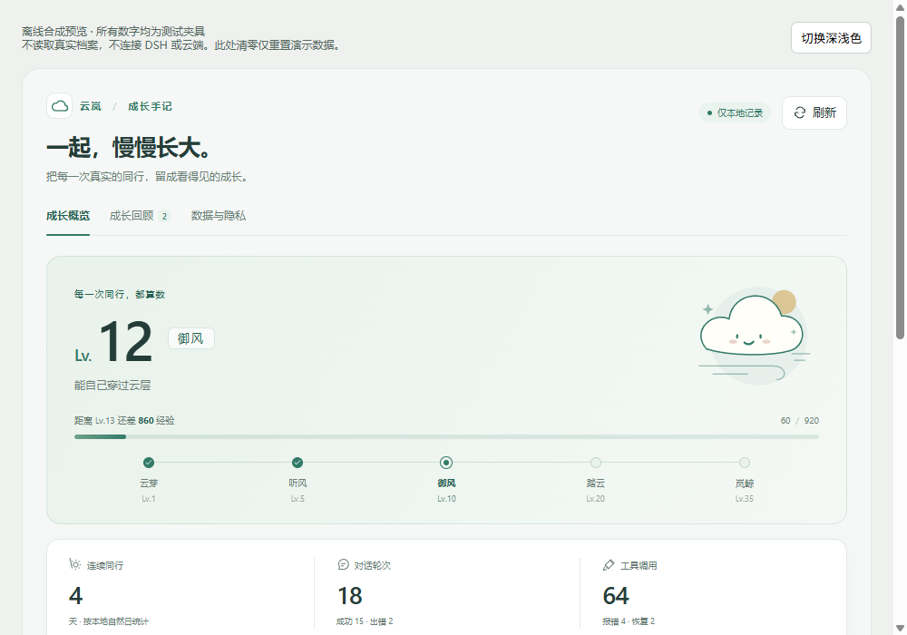
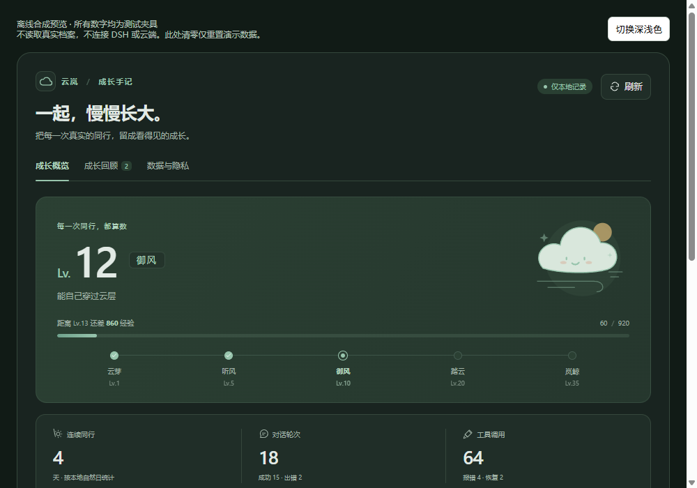
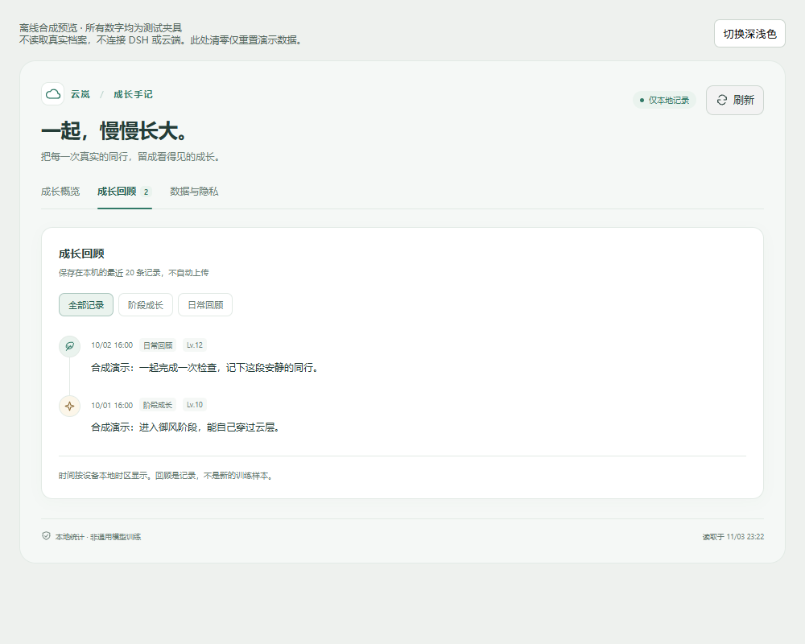
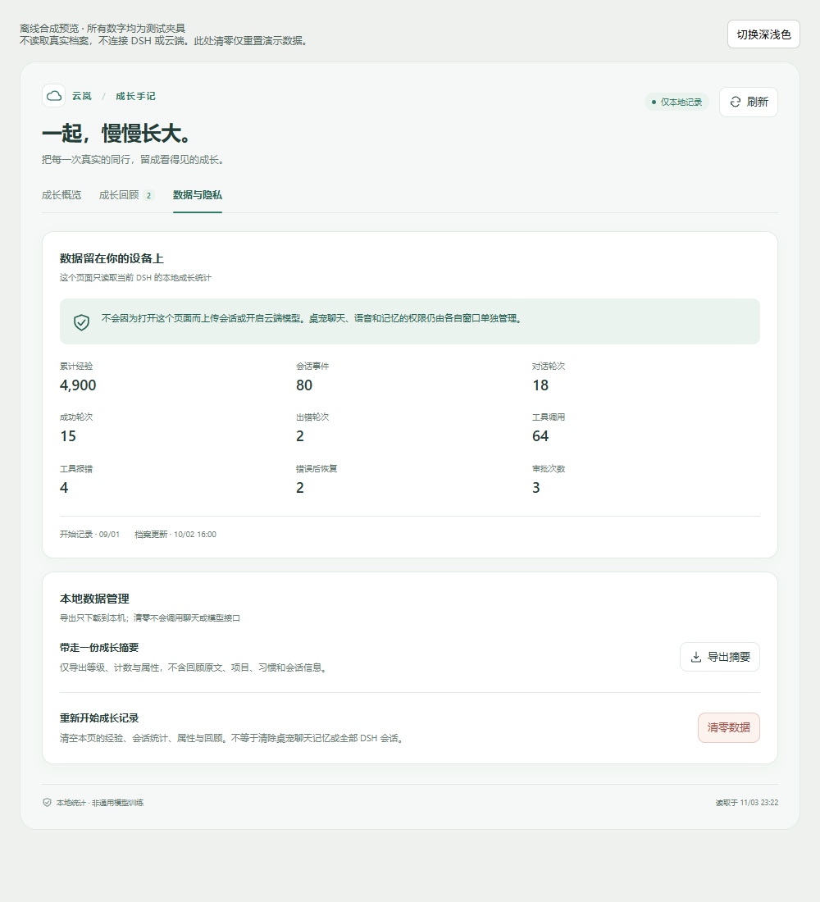
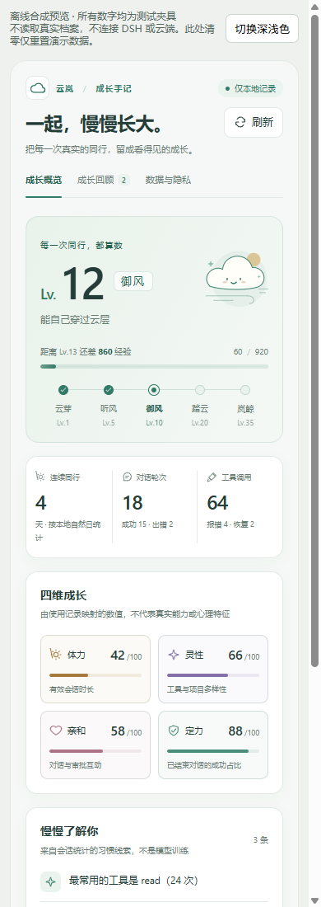

# 云岚 · 和日常一起长大

给 DSH 桌面伙伴一册本地成长手记：从会话事件积累经验，留下回顾与习惯线索，也让原生桌宠慢慢练出自己的动作偏好。

<code>v0.32.0</code> <code>Windows 10/11</code> <code>Node.js ≥ 22.19</code> <code>MIT code / CC BY-NC-SA assets</code>

[界面预览](#界面预览) · [快速开始](#快速开始) · [隐私与边界](#隐私与边界) · [自包含插件](docs/self-contained.md) · [安装与开发](docs/setup.md) · [更新记录](CHANGELOG.md)



*0.28.0 Web 成长手记 · 离线合成预览，不是已认证 DSH 宿主截图。图中数字、日期与回顾均为测试夹具。*

## 一册手记，两种陪伴

在 DSH 设置里看见自己的成长节奏；安装可选原生补丁后，在桌面上和云岚互动。
不需要为了养成开启云端，也不会用“学习”包装每一次下载与计数。

| 能做什么 | 如何呈现 |
| --- | --- |
| **成长有迹可循** | 会话、工具与审批事件换经验；等级、五阶段路线和四维属性一眼可见。 |
| **日常值得回看** | 成长回顾按阶段/日常筛选；习惯线索由本地计数推导，证据不足不编造。 |
| **桌面真的会练习** | 可选原生 helper 跑跳、摔倒与恢复；小型动作网络接收结果和明确反馈。 |
| **陪伴可调节** | 本地规则对话、模拟心情和互动记忆；漫游、搭话、减少动态可分别控制。 |
| **学习能分清来源** | 原生七页工作台区分动作拟合、情感适应、公开索引和数字审计。 |
| **数据由你决定** | Web 导出白名单统计摘要，清零需输入确认；原生记忆提供独立清除入口。 |

四维属性是统计映射，六维本领是练习指数；两者都不是心理测量、能力认证或模型准确率。

## 界面预览

### 原生工作台 · 安静、清楚、各页独立滚动

| 成长概览 | 情感工作台 | 训练总览 |
| :---: | :---: | :---: |
|  |  |  |

七页原生界面与 0.28.0 Web 设置页是不同入口，更新 Web 不会自动安装原生补丁。0.29.0 起桌面形象改由固定提交的 dsh-pet 渲染器显示；成长、记忆、人格、反馈与权限核心仍是原程序，回滚可恢复旧 Qt 形象。

<details>
<summary><strong>展开 Web 四景：深色、回顾、隐私与窄屏</strong></summary>

| 深色概览 | 成长回顾 |
| :---: | :---: |
|  |  |
| 数据与隐私 | 窄屏布局 |
|  |  |

这些画面只展示离线测试夹具；不证明当前已认证 DSH 宿主已加载新版。

</details>

[打开完整图鉴：6 张 Web + 7 张原生界面 →](docs/gallery.md)

全部公开预览只使用合成档案和隔离数据，不含用户聊天、真实计数或密钥。
档案日期与指标是演示值；页脚读取时间只表示预览渲染时刻，不是用户活动或真实模型效果。

## 快速开始

### 1. 启用 Windows 桌面插件

需要 **Windows 10/11、DSH 桌面版、Node.js ≥ 22.19**。
本仓库通过 GitHub 分发，不发布 npm 包。

1. 将仓库克隆或解压到 `%USERPROFILE%\.dsh\plugins\dsh-dafeiyu-growth`。
2. 重启 DSH 桌面版，在 **设置 → 插件** 中启用「云岚养成」。
3. 打开 **设置 → 内置插件 → 云岚养成**，查看成长概览、回顾与数据页。

不安装原生补丁也可使用 Web 成长统计；新安装默认不启用公开资料联网。
如果页面没有更新，先刷新现有 DSH 页面；不要把离线演示误当成宿主已更新。

### 2. 可选：构建原生桌宠补丁

仅适配上游 **`dsh-dafeiyu@0.1.23` 的 desktop profile**。
需要 Python 3.11；在仓库根目录运行：

```powershell
python -m pip install -r requirements-native.txt
.\native\build.ps1
.\native\install.ps1
```

构建可用 `-Python '你的Python路径'` 指定解释器；安装只重启桌宠，不重启 DSH。
脚本首次安装会备份上游 helper；需要恢复时：

```powershell
.\native\install.ps1 -Rollback
```

升级上游会覆盖补丁；其他版本须先适配，不能直接覆盖安装。
没有原版备份时不能保证回滚可用。仓库不分发构建好的 exe 或角色素材。

[完整安装、备份、配置、构建与故障说明 →](docs/setup.md)

### 3. 从一个小动作开始

- 右键原生角色 → **查看成长卡**：打开概览、本领、回顾、权限、情感、训练、数据。
- 右键 → **和云岚聊天…**：默认本地规则；可以试试「跳一个」「转一圈」。
- 用 **喜欢刚才的动作 / 这个动作不太行** 提供明确反馈。
- 想安静一会儿，分别关闭 **桌面漫游 / 主动搭话**，或开启 **减少动态**。

原生入口需要上述补丁；语音还取决于本机音频设备及预装的 Windows 中文 SAPI 引擎。

## 隐私与边界

- **本地优先**：成长统计、动作网络与规则对话在本机运行；默认语音使用 Windows SAPI，不保存录音。
- **授权分开**：文字云聊、连续上下文、记忆摘要、实时音频分别同意；关闭窗口撤销本次授权，不静默继承。
- **不扩张观察范围**：成长消费 DSH 提供的会话事件计数；不会为聊天额外读取屏幕、剪贴板、项目文件或其他会话原文；公开资料读取由独立开关控制。
- **清除范围明确**：Web 清零只处理成长档案，不等于删除全部原生记忆；称呼/喜好等本地明文记忆有独立清除入口。
- **电脑操作受限**：仅固定白名单，每次执行仍须物理点击确认；模型回复、语音“确认”和网页内容不能代替按钮。

云岚不是语言基础模型，没有主观意识，也不拥有 Live2D 素材授权。动作学习只是本地 10→12→4 小网络，情绪是线索与模拟，不是心理诊断。可选云端由你选择的第三方处理，其留存与费用政策仍适用；未完成真实云端端到端验证。本地保护也不是抵御同一 Windows 用户恶意进程的操作系统安全边界。详见 [安全说明](SECURITY.md)、[上下文与记忆授权](docs/companion-context.md) 和 [配置参考](docs/setup.md)。

## 0.32.0 自包含插件与 DSH-only 安装

- 新增 `src/native-supervisor.js`：DSH 插件自己启动、守护和停止原生 helper；有内置 `runtime/` 时不再依赖 `dsh-dafeiyu`。
- 没有 `runtime/` 的开发目录完全回退现有流程，不影响当前实例。
- 新增 onedir helper 构建 `native/build-onedir.ps1`，避免 onefile 每次解压 `MSVCP140.dll` 被杀毒/文件锁拦截。
- 新增 `tools/package-self-contained.ps1`：把 Electron、pinned renderer、onedir helper、插件代码和授权文件打成约 650MB 的自包含目录/压缩包。
- 可选轻量流程：`tools/fetch-runtime.ps1` 从固定 release 资产校验并安装 runtime；`-IncludeModels` 可把 24MB BGE 模型放进包内，supervisor 自动设置 `DSH_DAFEIYU_EMBEDDING_DIR`。
- 自包含包安装后只需 DSH 桌面版；本地成长、桌宠、动作、记忆、训练、菜单、SAPI 语音可用。云端聊天/语音仍需用户自己的 Key。
- 授权分层：代码 MIT；角色素材 CC BY-NC-SA 4.0；发布包 `license` 改为 `SEE LICENSE IN ASSET_LICENSE.md`，保留 `NOTICE.md` 与上游许可。
- 文档：[自包含打包与安装](docs/self-contained.md)
- 回归：102 项 Node 测试、930 项 Python 测试通过。

## 0.31.0 运动模型与偏好可视化

- 新增“运动模型”仪表：跑速、稳定率、爬起率，并直接显示公式和当前输入。
- 跑速 = 240 + 敏捷 × 1.8，范围 240–420 px/s；摔倒率 = 18% − 平衡×0.15% − 敏捷×0.05%，下限 5%。
- 明确区分三层：运动执行（跑/跳/摔/爬起 → 敏捷/平衡 → 速度/稳定）、动作选择（偏好观察 → 选哪个动作）、日常记忆（回应与选择语境）。
- **动作偏好记忆不会直接让跑速变快**；它改变动作选择与出现频率。跑速和稳定只由真实跑跳/摔倒结果训练。
- 动作偏好模型新增散点图：横轴出现次数（对数）、纵轴偏好权重（−1..+1），可看出 88 个动作的观察长尾与少量明确反馈。
- 新增 `movement_model.py` 和测试；预览见 [运动模型](native/verification/motion-redesign/synthetic-motion.png)、[偏好散点](native/verification/motion-redesign/synthetic-preference.png)（合成数据）。
- 回归：930 项 Python、95 项 Node 测试通过。

## 0.30.0 本领页统一为学习档案

- 新增纯数据层 `learning_archive.py`：练习、动作偏好、日常记忆、训练事件统一归一化，所有本地记录都算学习证据。
- 本领页新增“学习总览”：四类来源的数量、更新时间和跨来源“最近学习”时间线；不再只看某一个计数器。
- 修正练习记录口径：行为快照此前漏掉 `actions`，导致页面显示“动作 0”；现在与行为档案一致，并单独展示偏好观察次数。
- 动作偏好模型显示已建模动作数、观察次数、喜欢/不喜欢和最近更新时间，数据直接来自 `ActionPreferences.snapshot()`。
- “记住的日常”明确区分记忆引擎总记录（含公开/本地）与长期画像子集，不再用 4 条画像代表全部记忆。
- 能力雷达的计算加入动作偏好观察与记忆总量，练习记录和偏好反馈都会影响学习维度。
- 预览：[能力页合成预览](native/verification/learning-redesign/synthetic-populated-skills-456x640.png)；合成数据不代表真实用户数据。
- 回归：926 项 Python、95 项 Node 测试通过。

## 0.29.7 修复贴边菜单无法滚到底

- 面板最大高度改为跟随当前可见可用区，不再固定按整块窗口高度计算。
- 宠物靠近屏幕上/下边缘时，面板会缩到可见区域内，自身滚动条始终能看到最后一行；不再需要把云岚拖到屏幕中间。
- 短可用区实测：面板高 208px、内容高 601px，可完整内部滚动；根面板不再伸出屏幕。
- 回归：922 项 Python、95 项 Node 测试通过。

## 0.29.6 设置合并与菜单命令修复

- 移除“更多设置 → 原生菜单”的二级入口，语音与实时语音、云端接口、界面放大/缩小直接放在“设置”区。
- 动作分类从“全部动作 → 分类 → 动作”降为“分类 → 动作”：13 个分类在根面板按 3 列网格展示，菜单不再需要中间层。
- 补齐此前点击无反应的核心命令：`open-voice-tools`、`open-cloud-settings`、`open-realtime-settings`、`toggle-chatter`、`spin`、`scale-up`、`scale-down`；新增路由测试确保每个菜单命令都到达对应核心动作。
- 右键打开后，光标移动不足 6px 不会误开分类子菜单；分类改为点击或真正移动后展开。
- 回归：922 项 Python、95 项 Node 测试通过；helper 重新构建并在实机确认。

## 0.29.5 右键菜单架构重构

- 新增独立 `desktop/menu-ui.js`：分组卡片、统一图标、勾选状态、分区标题；根面板只创建常用项，动作分类与具体动作按需懒加载。
- 启动后预热隐藏菜单，实测首次右键构建从约 36ms 降到 **1.2ms**；实机右键到可见约 111ms（含系统点击/焦点/截图开销）。
- 子面板改为递归按需创建与清理；不再一次性生成 100+ DOM 节点。
- 安装脚本不再反复终止刚重启的 helper，避免额外启动失败。
- 迁移自查：固定运行时 301 文件校验通过；helper 与仓库构建哈希一致；宿主 7 个文件一致；成长/记忆/人格/连续性/行为/偏好/睡眠/布局 JSON 可读；109 段插帧完整。
- 回归：921 项 Python、95 项 Node 测试通过。

## 0.29.4 全部 109 段动作 60fps 化

- 已把全部 **109 段**动作生成 60fps 本地副本，存放在 `~/.dsh/yunlan-renderer/interpolated/`（约 176MB），宿主优先读取，源素材保持原样。
- 自检 109/109 通过：60fps、VP9 `ALPHA_MODE=1`、尺寸一致、可完整解码、时长差 <0.2s、透明边缘 alpha 与源一致；抽样 3 个快速动作在棋盘格上对比未见明显鬼影。
- 删除 `interpolated` 中某个文件即回退该动作；删除整个目录即全部回退 24fps 源。可用 `tools/check-interpolated.py` 复检，`tools/interpolate-actions.ps1` 重新生成。

## 0.29.3 常用动作 60fps 插帧试点

- 上游动作源为 **24fps**，这是剩余“动作有点顿”的主要来源；本轮用本地 ffmpeg 对 7 段常用动作做 60fps 运动插值，不覆盖原素材。
- 试点：待机呼吸休闲、原地左转奔跑、点击回应-开心跃动、点击回应-害羞惊讶、工作状态-思考冒泡、工作状态-雀跃庆祝、睡觉-循环。
- 插帧文件放在 `~/.dsh/yunlan-renderer/interpolated/`，宿主优先读取；删除某个文件即回退到固定源。已确认透明通道和 ALPHA_MODE 保留，棋盘格对比无明显鬼影。
- 复现脚本：[tools/interpolate-actions.ps1](tools/interpolate-actions.ps1)。先试这 7 段，确认手感后再决定是否扩展到全部动作。

## 0.29.2 右键菜单合并与流畅度

- 右键面板合并为单页常用操作：和云岚聊天、查看成长卡、喜欢/不喜欢刚才的动作、睡觉/起来、桌面漫游✓、减少动态✓、隐藏到托盘、动作▸、更多设置…
- “动作”仍是完整 109 段动画树；“更多设置…”才进入原生语音/云端/大小菜单，常用操作不再需要绕两层。
- 针对未聚焦透明窗口关闭 Chromium 后台节流（`backgroundThrottling:false`、禁用 renderer/occluded 后台降频），移动时暂停命中测试轮询，尺寸不变只更新位置。
- 实机右键面板已截图验证；菜单构建约 34ms；漫游、动作计数、偏好与睡眠保持正常。

## 0.29.1 修复卡顿、漫游与全动作学习

- 表现端窗口位置上报由逐帧降为 10Hz 合并发送，隐藏核心只在尺寸/位置真正变化时移动；核心动作/动画定时器在外部模式下降频，右键菜单构建实测约 34ms，整棵进程树 CPU 明显下降。
- 恢复桌面自由漫游：提高移动权重并增加空闲漫游心跳；实机 35 秒内窗口移动 71px，菜单点播的移动动作会真实位移。
- 全部 109 段动作都会记入练习：移动按距离记入小跑/敏捷，跳跃记入起跳，其他动作记入新增“桌面动作”并进入六维能力的行动/表达；成长卡练习记录新增桌面动作。
- 新增全动作偏好模型 `action_preferences.json`（v2）：动态记录实际播放的每个动作名与出现/喜欢/不喜欢计数；反馈菜单可训练任意动作，核心每 75 秒按偏好选播一个已学动作。它不替代 4 动作决策网络，也不写聊天或权限。
- 回归：**921 项 Python 测试**、**95 项 Node 测试**通过；实机验证漫游、动作计数、偏好持久化、睡眠与菜单延迟。

## 0.29.0 更新了什么

**桌面形象迁移到固定 dsh-pet 渲染器，核心与存档不变。**

- 固定上游 `3c99b1bb4d1bcb831880e8871718c50b64af0d9b`；npm 同版本包落后 13 个提交，未直接使用。运行时按 Git blob 校验重建 301 个文件，共享核心由固定源码重新生成。
- 原 Qt 核心继续持有成长、记忆、人格、反馈、权限、原生对话/成长卡/语音窗口；新 Electron 窗口只负责形象、气泡、菜单与点击表现。
- 核心与窗口用父子进程 + 随机命名管道的握手通信，没有无鉴权本地 HTTP；渲染器不提供云聊、余额、待办、截屏或麦克风接口。
- 动作只发语义意图，不伪造训练结果；右键“动作”树可点播全部 **109 段动画**，随机链、拖拽抛掷、点击回应与“睡觉/起来”保留。头部/戳一下点击仍交给原 `BehaviorLearner`。渲染器崩溃会触发核心退出并由 DSH 重启，`-Rollback` 实测恢复旧形象。
- 本次原生回归 **915 项 Python 测试**、**94 项 Node 测试**通过；真实核心 + 真实 Electron 窗口、隐藏/显示、真实鼠标点击写入互动计数、崩溃恢复与回滚均已实机验证。角色素材仍为上游非商用/CC BY-NC-SA 4.0。

[迁移与安全边界](docs/dsh-pet-pilot.md) · [完整版本记录](CHANGELOG.md)

## 0.28.0 更新了什么

**本次更新的是 Web 插件设置页，不是重做原生 helper。**

- 岚青成长手记：概览、成长回顾、数据与隐私三页，适配窄栏、宽屏与深浅色。
- 串行轮询、隐藏暂停、请求取消与旧回包隔离；失败保留旧状态，不把失败显示为成功。
- 导出仅含白名单统计摘要；清零短语确认、存储异常保护与键盘焦点恢复。

本次发布前复测 **61 项 Node 测试全部通过**，构建一致性与打包隐私检查通过；
原生 **903 项 Python 测试**属于 **0.27.1 历史验证**，没有作为本次 Web 更新重跑。
现有 DSH 入口刷新后仍曾返回 **401**，当前宿主是否加载新版尚未确认。
公开 Web 图片只能证明离线合成预览的布局，不能代替已认证宿主或真实云端验证。

[Web 架构与验证边界](docs/web-dashboard.md) · [完整版本记录](CHANGELOG.md)

## 开发与复现

Web 客户端使用宿主提供的 React；在仓库根目录安装依赖后可检查可复现产物：

```powershell
npm ci
npm run build:client
npm run check:client
npm test
```

`npm run preview:client` 生成离线合成预览，不连接真实成长档案。
原生测试、回环语音探针、隔离 smoke 与 live probe 的区别见 [开发参考](docs/setup.md)。
请勿为了截图开启真实档案探针；公开图片只接受合成数据。

## 文档导航

| 想了解什么 | 去这里 |
| --- | --- |
| 全部界面与截图来源 | [界面图鉴](docs/gallery.md) |
| 安装、回滚、数据路径、CLI、HTTP 与测试 | [安装与开发](docs/setup.md) |
| Web 分层、导出/清零与当前验证边界 | [Web 成长手记](docs/web-dashboard.md) |
| 原生七页设计与只读展示边界 | [原生工作台设计](docs/growth-redesign.md) |
| 上下文、检索标注与记忆同意 | [陪伴上下文](docs/companion-context.md) |
| 成长、记忆、人格的接口约定 | [引擎设计](docs/growth-engines.md) |
| 历史更新、指标与当时的限制 | [更新记录](CHANGELOG.md) |
| 安全报告与贡献 | [安全说明](SECURITY.md) · [贡献指南](CONTRIBUTING.md) |

## 许可与致谢

代码以 [MIT](LICENSE) 发布，派生自 [QCYTSN/dsh-dafeiyu](https://github.com/QCYTSN/dsh-dafeiyu)；
保留上游许可，Unicode CLDR、Stack Overflow 等来源分别遵循各自许可，见 [NOTICE](NOTICE.md)。

**角色素材不随仓库分发。** 请遵守上游 [素材许可](https://github.com/QCYTSN/dsh-dafeiyu/blob/main/ASSET_LICENSE.md)，
不要单独再分发不在 MIT 范围内的旧 BigFish 帧。公开预览仅含自绘界面与合成数据。

本项目是非官方粉丝作品，与 DeepSeek 无隶属或背书关系；名称、商标与角色权利归各自权利人。

