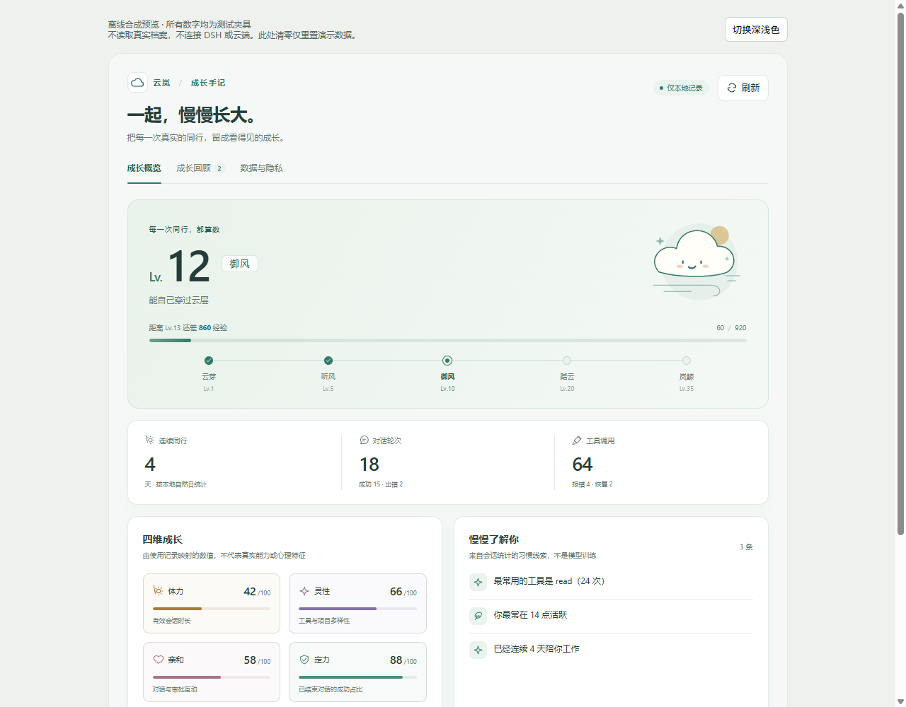
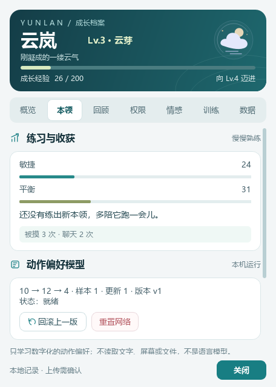
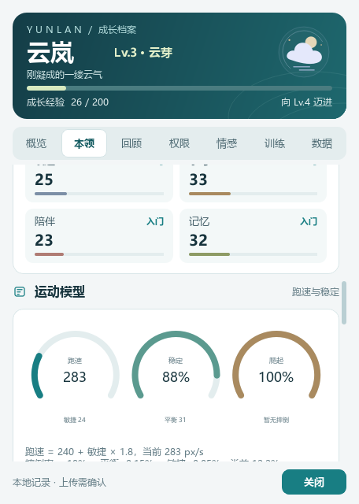

<div align="center">
  
</div>

# 大肥鱼养成记 · 云岚

**一只会陪你工作，也会自己练本领的 DSH 桌面伙伴。**

云岚不是只会弹窗的桌宠。你与 DSH 的每一次协作，会慢慢变成她的等级、本领、回忆和一点点自己的偏好；她也会在桌面上走动、发呆、回应你的摸头和点击。成长数据默认留在本地，想聊天时再单独授权云端。

<code>v0.32.0</code> <code>Windows 10/11</code> <code>DeepSeek Harness</code> <code>本地优先</code> <code>MIT code / CC BY-NC-SA assets</code>

**快速导航：** [她是什么](#她是什么) · [成长系统](#成长系统) · [界面一览](#界面一览) · [安装](#安装) · [隐私边界](#隐私边界) · [文档](#文档导航) · [更新记录](CHANGELOG.md)

---

## 她是什么

云岚把“桌面陪伴”和“成长记录”放在同一只桌宠身上：

| 你会看到 | 她实际在做什么 |
| --- | --- |
| **桌面上的一只云岚** | 待机、慢走、转身、被拖动、被抛起、睡觉；109 段动作按场景播放 |
| **一本成长手记** | 把会话、工具调用、审批和陪伴时间换算成等级、经验与四维属性 |
| **六维本领与运动模型** | 把练习、动作偏好、记忆和训练记录变成可解释的练习指数，不是能力认证 |
| **会记得你的云岚** | 记住称呼、喜好、互动次数与最近一起做过的事；可查看、可清除 |
| **有边界的陪伴** | 本地规则对话默认可用；云端聊天、语音、记忆摘要和电脑操作分别授权 |

她不是大语言模型，也没有主观意识。动作学习是一个很小的本地网络；情绪是线索与模拟，不是心理诊断。

## 成长系统

### 三条线，各管各的

| 线 | 输入 | 输出 |
| --- | --- | --- |
| **等级与四维属性** | 有效会话时长、工具/项目多样性、对话与审批互动、已结束会话的成功占比 | 等级、阶段、体力/灵性/亲和/定力 |
| **六维本领** | 练习、桌面动作、动作偏好观察、日常记忆、训练事件 | 行动、平衡、表达、学习、记忆、陪伴 |
| **运动模型** | 真实跑、跳、摔倒与爬起结果 | 跑速、稳定率、爬起率；偏好只改动作选择，不直接改速度 |

四维属性是统计映射，六维本领是练习指数，运动模型是本地行为推导；三者都不是心理测量、通用模型训练或能力认证。

### 本领页 · 运动模型

<p align="center">
  
  
</p>

- **跑速**：`240 + 敏捷 × 1.8`，范围 240–420 px/s
- **稳定**：由平衡与敏捷推导；摔倒率有 5% 下限
- **爬起**：没有摔倒记录时显示 100%，不把“没练过”伪装成“很会”
- **偏好散点**：横轴出现次数，纵轴偏好权重；看得见哪些动作常出现、哪些得到明确反馈

运动模型的目的不是给云岚打分，而是让你看懂：她为什么跑得快/慢、稳/不稳，以及下一步该练什么。

### 109 段动作，真的会动

- 桌宠形象由固定提交的 `dsh-pet` 渲染器显示，核心成长/记忆/人格/权限仍是原程序
- 右键动作树可点播全部 109 段动画；拖拽抛掷、点击回应、睡觉/起来保留
- 常用运动动作使用本地 60fps 覆盖层；复杂特效自动回退 24fps 源，优先保证稳定
- 单实例锁防止重复桌宠；动作切换只保留一帧可见，避免重影

## 界面一览

### Web 成长手记

DSH 设置 → 内置插件 → 云岚养成。

| 成长回顾 | 数据与隐私 |
| :---: | :---: |
|  |  |
| 按阶段与日常回看，不把每次下载包装成学习。 | 导出只含白名单统计摘要；清零需要明确确认。 |

### 桌面上的她

<p align="center">
  
</p>

右键就能查看成长卡、聊天、转一圈、给动作反馈、开关漫游/主动搭话，或减少动态。常用操作不再绕两层菜单。

### 原生七页

<p align="center">
  
  
</p>

概览、本领、回顾、权限、情感、训练、数据七页各自滚动；情感页区分模拟心情与用户情绪线索，训练页区分动作拟合、情感适应和资料索引。

> 所有公开截图只使用合成档案与隔离数据，不含真实聊天、项目名、计数或 Key。Web 图是 0.28.0 离线预览；原生图来自 0.28–0.31 的合成预览，用于展示布局与模型，不代表你的真实数据。

## 她怎么陪你

- **工作时**：安静待在角落，按状态说一句话；不主动打开云端聊天或麦克风。
- **想互动时**：摸头、戳肚子、拖动、抛起、转一圈；“喜欢/不喜欢刚才的动作”会同时改变动作偏好、人格倾向和长期记忆，下一次选择与语气会受影响。
- **想成长时**：看成长手记、六维雷达、运动模型和最近学习；知道自己练了什么。
- **想安静时**：分别关闭桌面漫游、主动搭话，或开启“减少动态”。
- **想整理时**：导出白名单统计摘要、清除互动记忆、重置动作网络；高风险操作不在能力内。

## 安装

**最省事：自包含包（推荐给只想用桌宠的人）**

把发布包解压到：

```text
%USERPROFILE%\.dsh\plugins\dsh-dafeiyu-growth
```

重启 DSH 桌面版，在 **设置 → 插件** 启用「云岚养成」。包内已带 Electron、固定渲染器、onedir helper 与运行依赖；安装后不再依赖单独的 `dsh-dafeiyu`。详见 [自包含打包与安装](docs/self-contained.md)。

**从源码开发**

需要 Windows 10/11、DSH 桌面版、Node.js ≥ 22.19；原生 helper 另需 Python 3.11。

```powershell
npm ci
npm run build:client
npm run check:client
npm test
```

原生补丁只适配上游 `dsh-dafeiyu@0.1.23` 的 desktop profile；构建、安装、回滚与数据路径见 [安装与开发](docs/setup.md)。

## 隐私边界

- **本地优先**：成长统计、动作网络、规则对话和互动记忆在本机运行；默认语音使用 Windows SAPI，不保存录音。
- **分别授权**：文字云聊、连续上下文、记忆摘要、实时音频分别同意；关闭窗口即撤销本次授权，不静默继承。
- **不做扩张观察**：只消费 DSH 提供的会话事件计数，不读取项目文件、屏幕、剪贴板或其他会话原文。
- **清除范围明确**：Web 清零只处理成长档案，不等于删除全部原生记忆；称呼/喜好等明文记忆有独立清除入口。
- **显式备份**：`python native/state_backup.py backup` 可创建带哈希校验的本地快照；恢复前自动再做安全快照，不会在后台偷偷保留已删除记忆。说明见 [安装与开发](docs/setup.md)。
- **电脑操作受控**：只走固定白名单，每次执行仍需物理点击确认；模型回复、语音和网页内容不能代替按钮。
- **不是安全边界**：本地保护不防御同一 Windows 用户下的恶意进程；详见 [安全说明](SECURITY.md)。

## 文档导航

| 想了解什么 | 去这里 |
| --- | --- |
| 全部界面与截图来源 | [界面图鉴](docs/gallery.md) |
| 安装、回滚、数据路径、CLI、HTTP 与测试 | [安装与开发](docs/setup.md) |
| Web 分层、导出/清零与验证边界 | [Web 成长手记](docs/web-dashboard.md) |
| 原生七页设计与只读展示边界 | [原生工作台设计](docs/growth-redesign.md) |
| 上下文、检索标注与记忆同意 | [陪伴上下文](docs/companion-context.md) |
| 成长、记忆、人格的接口约定 | [引擎设计](docs/growth-engines.md) |
| 自包含打包、DSH-only 安装与授权 | [自包含插件](docs/self-contained.md) |
| 历史更新、指标与当时的限制 | [更新记录](CHANGELOG.md) |
| 安全报告与贡献 | [安全说明](SECURITY.md) · [贡献指南](CONTRIBUTING.md) |

## 最近更新

- **0.32.0**：DSH-only 自包含插件、native supervisor、onedir helper、素材审计、单实例锁、拖拽/切换闪现修复、气泡清晰度修复。
- **0.31.0**：运动模型仪表与动作偏好散点图。
- **0.30.0**：本领页统一为学习档案。
- **0.29.4**：109 段动作 60fps 覆盖层。

完整变更与已知限制见 [CHANGELOG.md](CHANGELOG.md)。

## 许可与致谢

**代码与角色素材分开授权。**

- **本插件源代码**：[MIT](LICENSE)，派生自 [QCYTSN/dsh-dafeiyu](https://github.com/QCYTSN/dsh-dafeiyu)，保留 `native/upstream-LICENSE`。
- **桌面渲染器代码**：来自 [PC2005-cloud/dsh-pet](https://github.com/PC2005-cloud/dsh-pet)，MIT；固定提交 `3c99b1bb4d1bcb831880e8871718c50b64af0d9b`。
- **角色形象与 109 段动画**：适用 **CC BY-NC-SA 4.0**（署名、非商业、相同方式共享），不是 MIT；原作者与固定提交见 [ASSET_LICENSE.md](ASSET_LICENSE.md)。
- **自包含发行包**：包含 dsh-pet 角色动画，必须保留 `ASSET_LICENSE.md`、`NOTICE.md`、上游链接与署名，不能把整包标成单一 MIT。商业使用需向上游权利人另行取得许可。
- **本仓库公开截图**：只含自绘 UI 与合成数据，不包含角色帧；新增的本领/运动模型截图同样不改变上述授权分层。

Unicode CLDR、Stack Overflow 等第三方来源分别遵循各自许可，完整清单见 [NOTICE.md](NOTICE.md)。

本项目是非官方粉丝作品，与 DeepSeek 无隶属或背书关系；名称、商标与角色权利归各自权利人。
