# 云岚 · 界面图鉴

[返回首页](../README.md) · [安装与开发](setup.md) · [历史更新](../CHANGELOG.md)

这里展示 **6 张 Web + 7 张原生**公开预览。两套界面入口不同：Web 位于 DSH 设置 → 内置插件 → 云岚养成；原生七页成长卡需要可选 helper 补丁。

## 截图来源与隐私

- 全部图片仅使用离线合成档案、显式测试夹具和隔离目录；不展示真实用户档案、聊天、密钥或实际使用计数。
- 档案日期、等级、回顾与训练数字均来自夹具；Web 页脚读取时间仅为预览渲染时刻。它们不是维护者活动记录，也不代表真实用户效果或当前模型指标。
- Web 图片来自 0.28.0 的离线合成预览，不是已认证 DSH 宿主截图。现有 DSH 入口仍曾返回 401，当前宿主是否挂载新版尚未确认。
- 原生图片来自合成成长卡渲染，不代表 0.28.0 重做了原生程序；原生最近补丁为 0.27.1，其 903 项 Python 测试属于历史验证，本次未重跑。
- 用户实机截图、聊天截图和含真实统计的验证产物不在本图鉴中。离线画面不能证明云端服务、麦克风、电脑操作或真实端到端链路已验证。

截图生成来源、尺寸与 SHA-256 清单见 [公开截图来源](screenshots/PROVENANCE.md)。

## Web · 0.28.0 成长手记

### 浅色概览

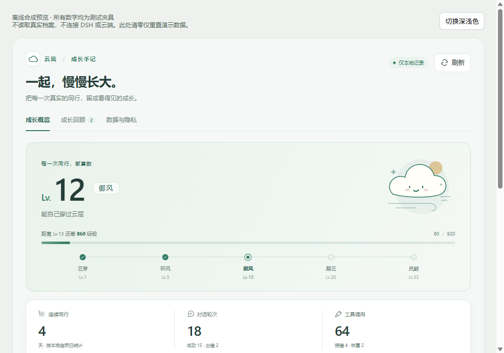

等级进度、五阶段路线、关键统计与四维属性集中呈现；所有计数与日期均为合成演示值。

### 深色概览

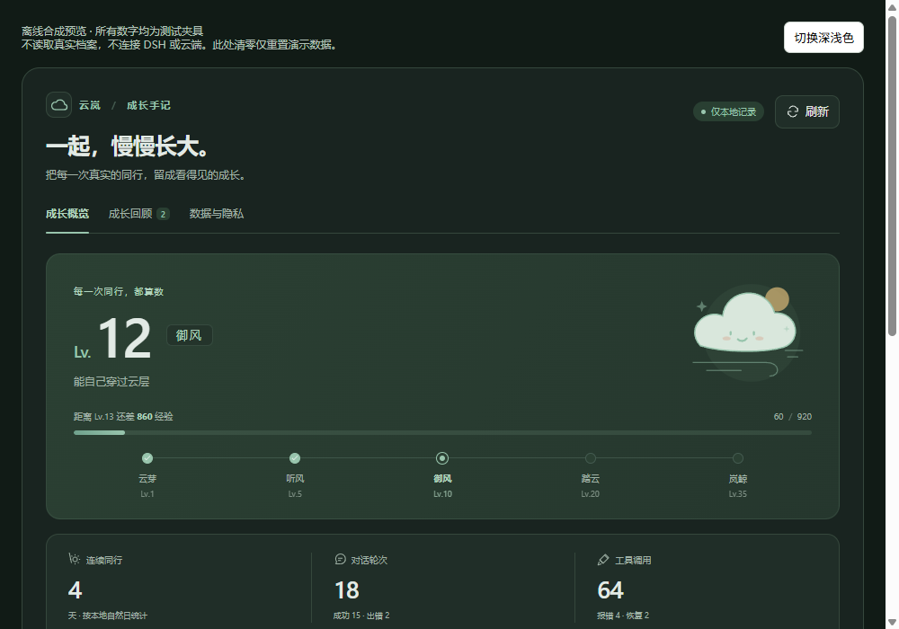

同一离线夹具的深色布局；并非另一位用户档案，也不是宿主认证验证。

### 成长回顾

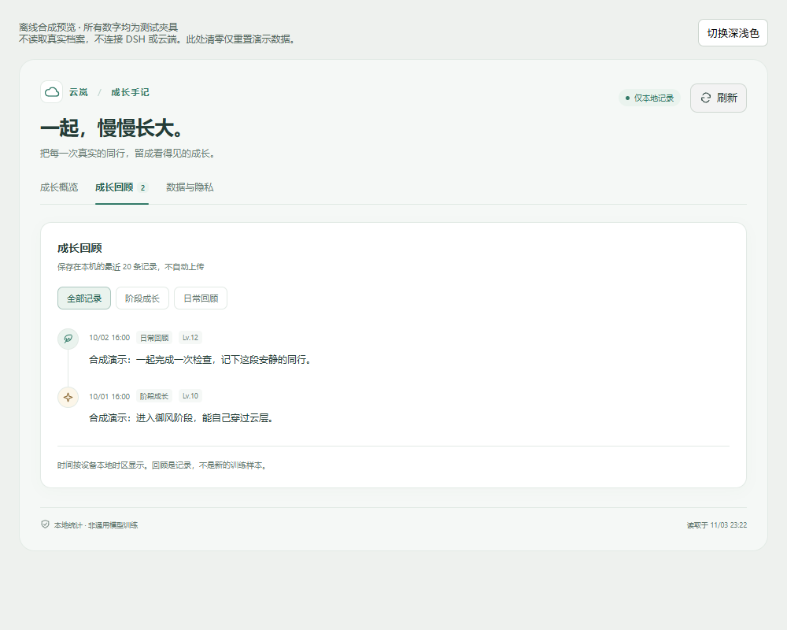

回顾列表与分类筛选；文字和时间戳由测试夹具提供，不含真实项目、工具或聊天记录。

### 数据与隐私

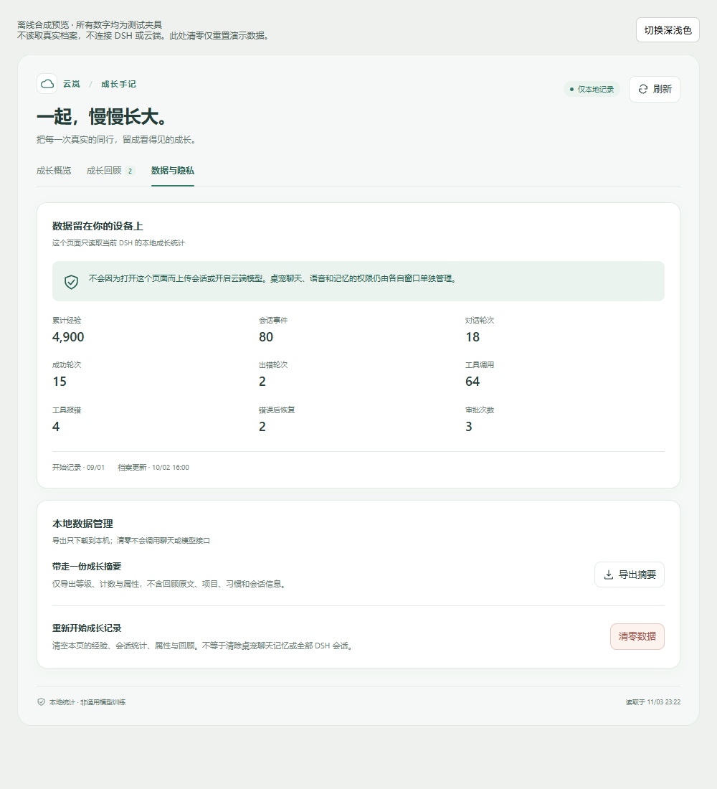

统计详情、摘要导出说明与独立清零确认区。演示清零仅改变离线对象，不处理任何真实档案。

### 窄屏布局

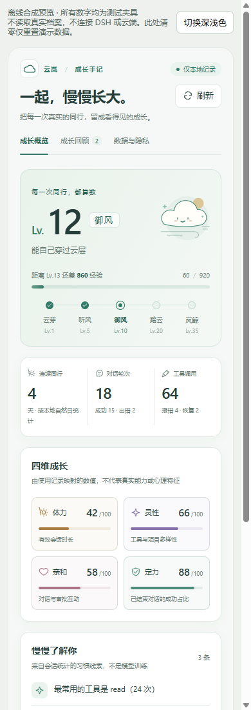

窄栏单列阅读与触控尺寸展示；这是布局预览，不表示发布了独立手机应用。

### 宽屏布局

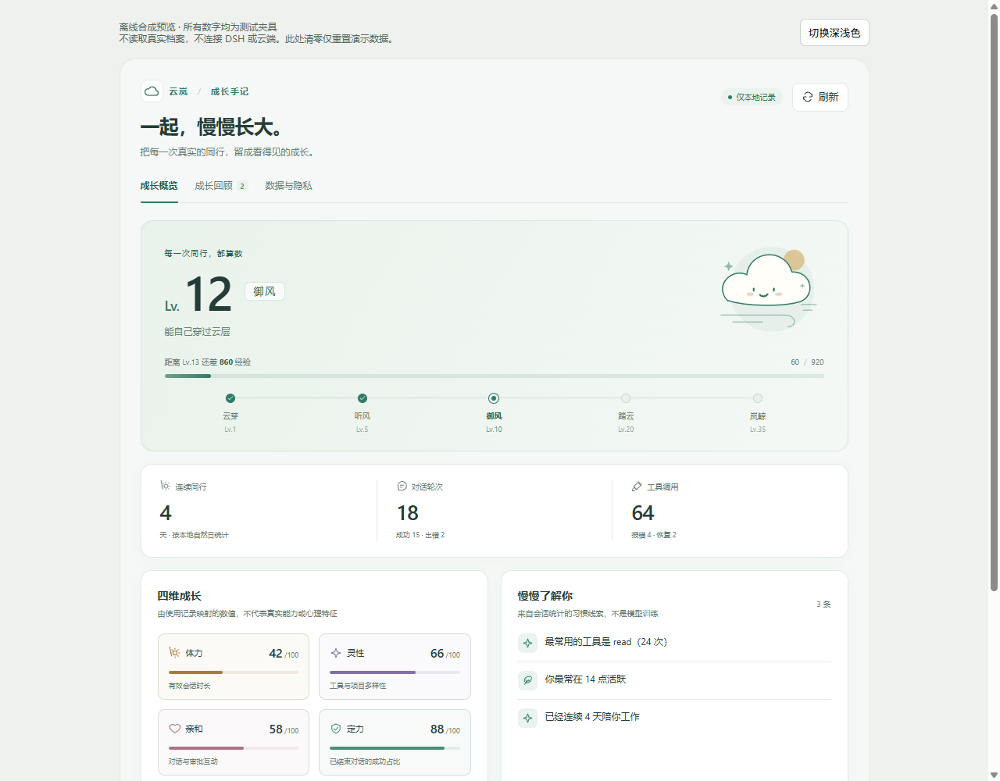

宽容器下的信息分栏，同样只使用合成数据。具体断点与键盘行为见 [Web 架构说明](web-dashboard.md)。

## 原生 · 七页成长工作台

原生预览统一使用自绘界面、合成档案与隔离数据，不包含不可分发的角色帧。数字用于展示版式，不可据此推断模型准确率、训练进步或真实用户活动。

| 成长概览 | 六维本领 |
| :---: | :---: |
| 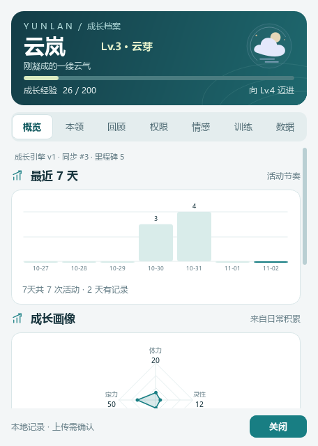 | 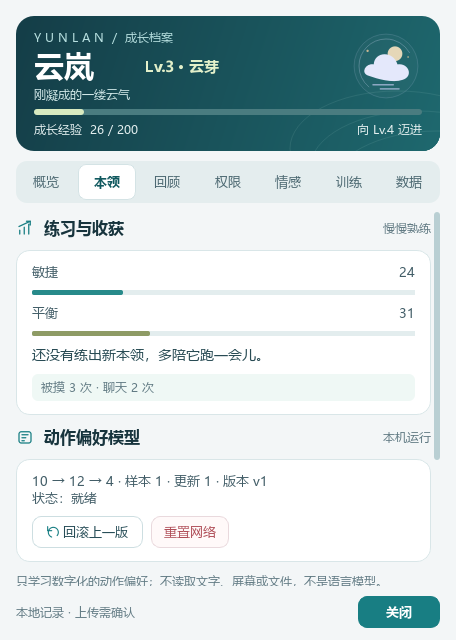 |
| 等级、属性与陪伴节奏；时间和计数均为夹具。 | 六维练习指数与动作模型状态，不是能力认证。 |

### 运动模型特写

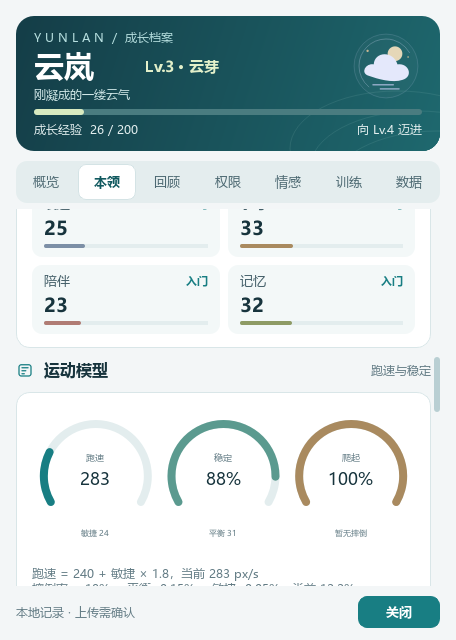

跑速、稳定率、爬起率与公式；偏好记忆只改动作选择，不直接改速度。

| 成长回顾 | 权限边界 |
| :---: | :---: |
| 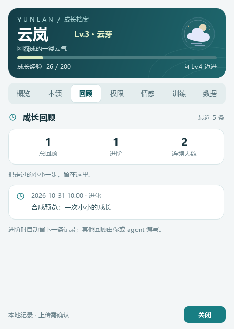 | 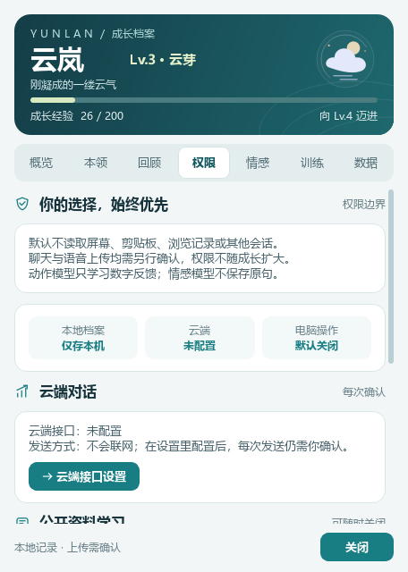 |
| 合成成长时间线，不含真实回顾或会话。 | 本地、云端与电脑操作的范围说明，不代表已授权。 |

| 情感工作台 | 训练总览 |
| :---: | :---: |
| 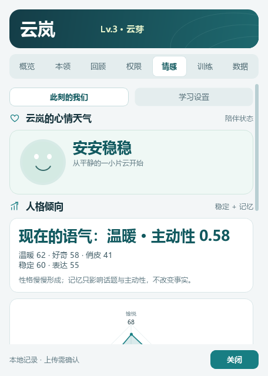 | 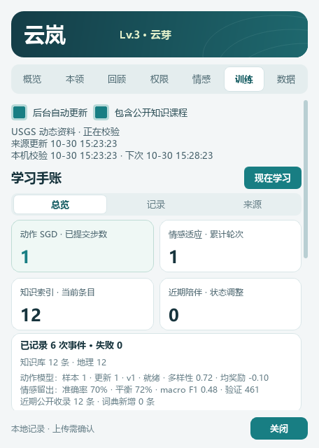 |
| 区分模拟心情与用户情绪线索，不作心理诊断。 | 区分动作拟合、情感适应与资料索引，数字为演示。 |

### 数据档案

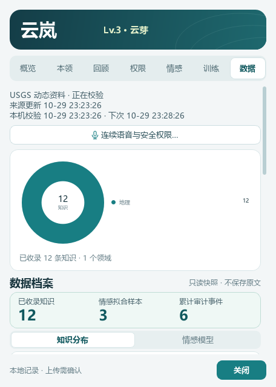

知识与情感数据的只读快照；不是用户真实知识库或当前效果评估。更多原生设计与合成预览方法见 [七页重设计说明](growth-redesign.md)。

## 复现与边界

在仓库根目录运行 `npm ci` 后，使用 `npm run preview:client` 生成离线 Web 预览。原生合成渲染使用 `python native/render_growth_preview.py`，所需依赖和隔离规则见 [安装与开发](setup.md)。这些命令不等于生成仓库中所有截图的自动截图脚本。

请勿为更新公开截图运行真实档案的 live probe，或用真实计数替换夹具。离线展示、单元测试、宿主集成和真实云端端到端测试是不同证据；本图鉴只说明图片来源，不扩大验证声明。
