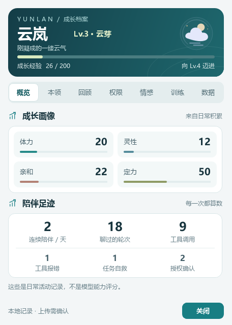
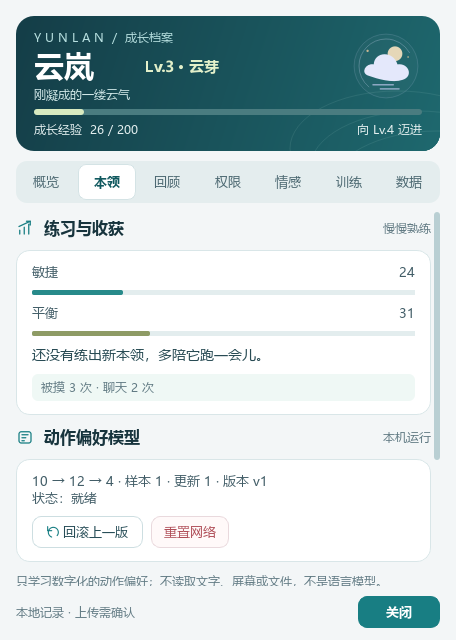
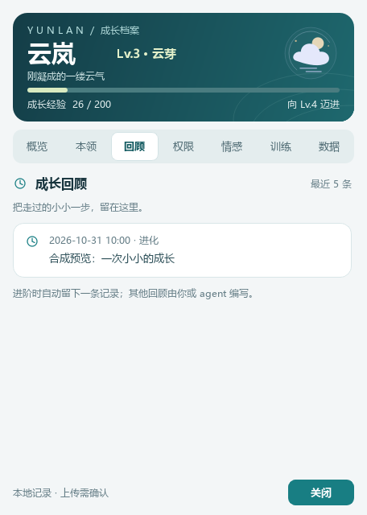
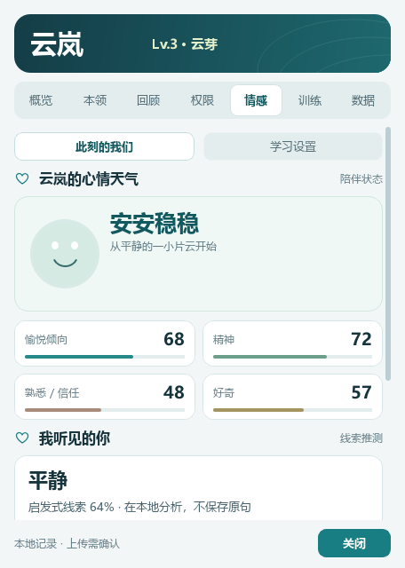
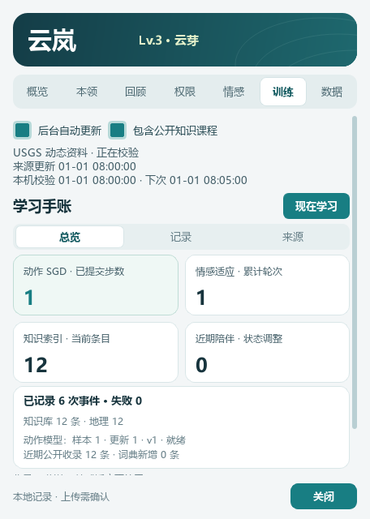
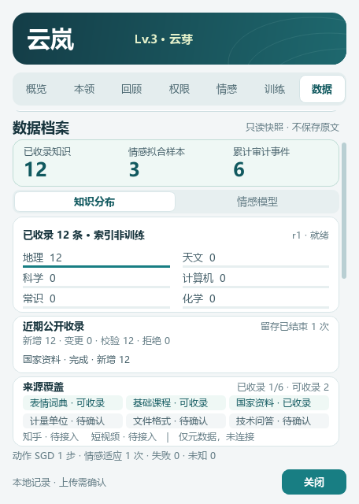

# 云岚 0.10.0 · 岚青成长工作台

本轮只调整原生界面与展示层，沿用全部七页、统计字段、数据格式、学习开关、确认入口与权限逻辑。没有增加无关功能，也没有连接真实语音服务。

## 视觉系统

- 岚青主色 `#187E83`，深青标题 `#17343D`、浅雾画布 `#F3F6F7`、白色卡片与清晰描边。
- 等级/经验在封面首要展示；工作台页使用紧凑封面，留出更多有效阅读空间。
- 2×2成长属性、主次分级的陪伴数字、独立分组的语音/操作统计；指标不混算为模型训练。
- 原创矢量线图标，无外部角色图片；主要动作、危险动作、选中、悬停、按下、键盘聚焦、不可用状态统一。
- 空白、有数据和错误状态分别呈现；状态同时提供文字，不只使用颜色。

## 七页预览

以下均为合成数据，并非主人的真实档案、活动或训练成果。

| 概览 | 本领 |
| --- | --- |
|  |  |

| 回顾 | 权限 |
| --- | --- |
|  |  |

| 情感 | 训练 |
| --- | --- |
|  |  |

## 交互与布局

默认456×640，最小420×480；各页独立滚动，关闭按钮固定在窗口内。情感双视图、训练三视图、数据双视图保持原来的筛选/分页/详情/选择与滚动状态；刷新不会自动发出学习或权限信号。危险操作仍需原来的确认对话框。

## 验证

- 654项原生测试、36项插件测试通过。
- 72张合成截图：空白/有数据/错误 × 12个页面或子视图 × 两种窗口尺寸；所有关闭按钮均位于窗口内，底部保留12px。
- 对页面切换、纯数据显示、原始数据值、键盘聚焦、禁用状态、无横向滚动和固定底栏增加回归验证。
- 通过隔离数据的打包smoke；本次验证不打开麦克风、不使用主人接口Key、不向真实服务上传音频、不执行真实电脑操作。
- 可复现命令：`python native/render_growth_preview.py`；生成目录`native/verification/redesign/`已被Git忽略。

本轮未自动提交或推送GitHub；待界面验收后再发布。
